# 地形对照图册

[返回总览](README.md)

全部参数示意图，非仿真截图。轴为米，竖向视觉比例放大；随机纹理/API几何不精确复现。粉点为名义出生区域，非所有随机出生。d=1为配置端点，不保证课程实际采样。tunnel缺参不代填；复旦历史地形实现未保存时明确标注。

| 图号 | 学校 | 类型 | 使用配置数 | 证据备注 |
|---|---|---|---|---|
| T001 | 我们 | 无限平面 | 1 | 仅显示8×8米窗口，非有限地块 |
| T002 | 我们 | stairs / flat | 1 | 非平地从接近平台进入；平地从中心区域出生 |
| T003 | 我们 | stairs / up_one | 1 | 非平地从接近平台进入；平地从中心区域出生 |
| T004 | 我们 | stairs / down_one | 1 | 非平地从接近平台进入；平地从中心区域出生 |
| T005 | 我们 | stairs / mixed_one | 1 | 非平地从接近平台进入；平地从中心区域出生 |
| T006 | 我们 | stairs / mixed_fast | 1 | 非平地从接近平台进入；平地从中心区域出生 |
| T007 | 我们 | stairs / up_two | 1 | 非平地从接近平台进入；平地从中心区域出生 |
| T008 | 我们 | stairs / down_two | 1 | 非平地从接近平台进入；平地从中心区域出生 |
| T009 | 我们 | stairs / mixed_two | 1 | 非平地从接近平台进入；平地从中心区域出生 |
| T010 | 我们 | stairs / grid | 1 | 非平地从接近平台进入；平地从中心区域出生 |
| T011 | 我们 | stairs / slope | 1 | 非平地从接近平台进入；平地从中心区域出生 |
| T012 | 我们 | stairs / rough | 1 | 非平地从接近平台进入；平地从中心区域出生 |
| T013 | 我们 | recovery / flat | 1 | 内置Hf粗糙仅画类型示意 |
| T014 | 我们 | recovery / one | 1 | 内置Hf粗糙仅画类型示意 |
| T015 | 我们 | recovery / two | 1 | 内置Hf粗糙仅画类型示意 |
| T016 | 我们 | recovery / slope | 1 | 内置Hf粗糙仅画类型示意 |
| T017 | 我们 | recovery / bumps | 1 | 内置Hf粗糙仅画类型示意 |
| T018 | 我们 | recovery / rough | 1 | 内置Hf粗糙仅画类型示意 |
| T019 | 我们 | spin / flat | 1 | 坡道出生在坡面；rough为类型示意 |
| T020 | 我们 | spin / slope | 1 | 坡道出生在坡面；rough为类型示意 |
| T021 | 我们 | spin / rough | 1 | 坡道出生在坡面；rough为类型示意 |
| T022 | 我们 | 跳隧道横梁及护栏 | 1 | 横梁x仅为排版；接近距离、护栏厚度待定，故不画出生点 |
| T023 | 华南虎 | 无限平面 | 3 | 仅显示9×9米窗口 |
| T024 | 华南虎 | tiny_step_rot | 7 | 按参数重建形状示意；非Isaac碰撞网格，坡度不当弧度 |
| T025 | 华南虎 | slope_for_rm_low | 7 | 按参数重建形状示意；非Isaac碰撞网格，坡度不当弧度 |
| T026 | 华南虎 | inv_slope_for_rm_low | 9 | 按参数重建形状示意；非Isaac碰撞网格，坡度不当弧度 |
| T027 | 华南虎 | stair_slope_for_rm_low | 7 | 按参数重建形状示意；非Isaac碰撞网格，坡度不当弧度 |
| T028 | 华南虎 | stair_slope_for_rm_mid | 1 | 按参数重建形状示意；非Isaac碰撞网格，坡度不当弧度 |
| T029 | 华南虎 | inv_stair_slope_for_rm_low | 9 | 按参数重建形状示意；非Isaac碰撞网格，坡度不当弧度 |
| T030 | 华南虎 | inv_stair_slope_for_rm_mid | 1 | 按参数重建形状示意；非Isaac碰撞网格，坡度不当弧度 |
| T031 | 华南虎 | plane_for_rm_rot | 9 | 按参数重建形状示意；非Isaac碰撞网格，坡度不当弧度 |
| T032 | 华南虎 | random_uniform_for_rm | 8 | 按参数重建形状示意；非Isaac碰撞网格，坡度不当弧度 |
| T033 | 华南虎 | tiny_step | 2 | 按参数重建形状示意；非Isaac碰撞网格，坡度不当弧度 |
| T034 | 华南虎 | slope_for_rm_high | 2 | 按参数重建形状示意；非Isaac碰撞网格，坡度不当弧度 |
| T035 | 华南虎 | high_stair_for_rm | 1 | 按参数重建形状示意；非Isaac碰撞网格，坡度不当弧度 |
| T036 | 华南虎 | stair_slope_for_rm_high | 2 | 按参数重建形状示意；非Isaac碰撞网格，坡度不当弧度 |
| T037 | 华南虎 | inv_stair_slope_for_rm_high | 2 | 按参数重建形状示意；非Isaac碰撞网格，坡度不当弧度 |
| T038 | 华南虎 | random_uniform_for_rm | 1 | 按参数重建形状示意；非Isaac碰撞网格，坡度不当弧度 |
| T039 | 华南虎 | cliff_inv_stair_slope_short_for_rm | 2 | 按参数重建形状示意；非Isaac碰撞网格，坡度不当弧度 |
| T040 | 华南虎 | low_speed_stair_for_rm | 1 | 按参数重建形状示意；非Isaac碰撞网格，坡度不当弧度 |
| T041 | 华南虎 | high_speed_stair_for_rm | 1 | 按参数重建形状示意；非Isaac碰撞网格，坡度不当弧度 |
| T042 | 华南虎 | stair_slope_for_rm_mid | 2 | 按参数重建形状示意；非Isaac碰撞网格，坡度不当弧度 |
| T043 | 华南虎 | inv_stair_slope_for_rm_mid | 2 | 按参数重建形状示意；非Isaac碰撞网格，坡度不当弧度 |
| T044 | 复旦 | 平地 | 1 | 历史未保存terrain.py，按现有工具示意，不能证明历史网格 |
| T045 | 复旦 | 光滑凸坡 | 1 | 历史未保存terrain.py，按现有工具示意，不能证明历史网格 |
| T046 | 复旦 | 光滑凹坡 | 1 | 历史未保存terrain.py，按现有工具示意，不能证明历史网格 |
| T047 | 复旦 | 粗糙凸坡 | 1 | 历史未保存terrain.py，按现有工具示意，不能证明历史网格 |
| T048 | 复旦 | 粗糙凹坡 | 1 | 历史未保存terrain.py，按现有工具示意，不能证明历史网格 |
| T049 | 复旦 | 下阶凹地形 | 1 | 历史未保存terrain.py，按现有工具示意，不能证明历史网格 |
| T050 | 复旦 | 上阶凸地形 | 1 | 历史未保存terrain.py，按现有工具示意，不能证明历史网格 |
| T051 | 复旦 | 离散障碍 | 1 | 历史未保存terrain.py，按现有工具示意，不能证明历史网格 |
| T052 | 复旦 | 踏石（未启用） | 1 | 生成分支存在，但所查配置均未启用；踏石间隙示意深度非配置值 |
| T053 | 复旦 | 沟槽（未启用） | 1 | 生成分支存在，但所查配置均未启用；踏石间隙示意深度非配置值 |
| T054 | 复旦 | 坑（未启用） | 1 | 生成分支存在，但所查配置均未启用；踏石间隙示意深度非配置值 |

## 台阶

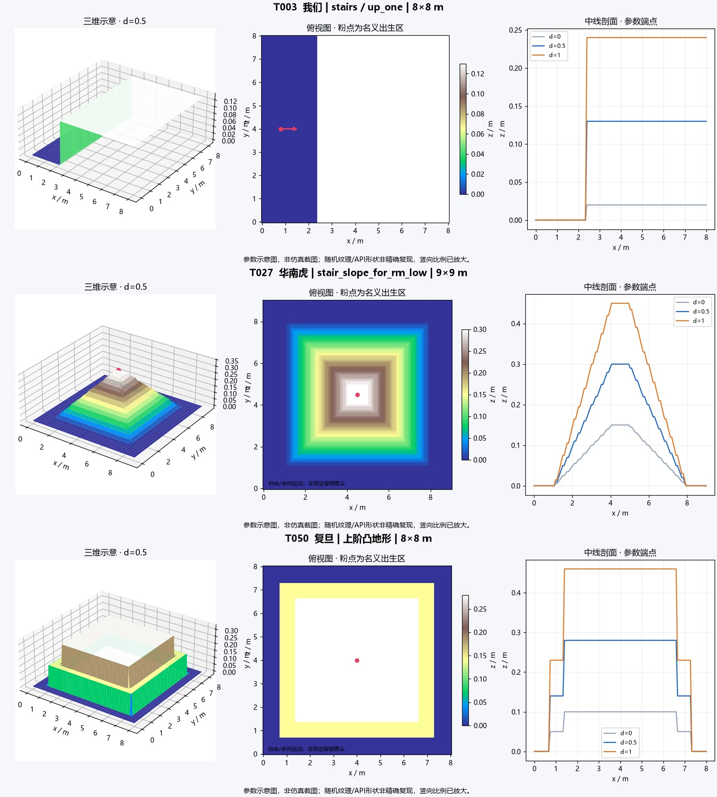

## 粗糙与粗糙坡

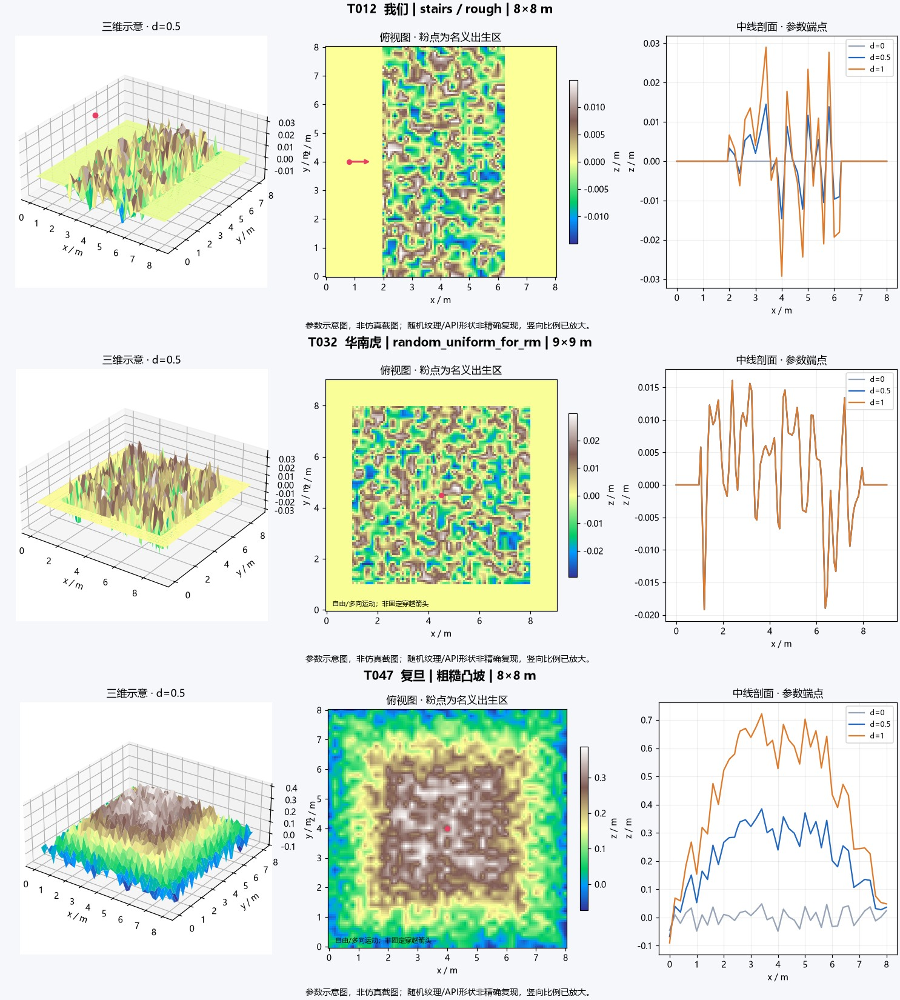

## 坡道

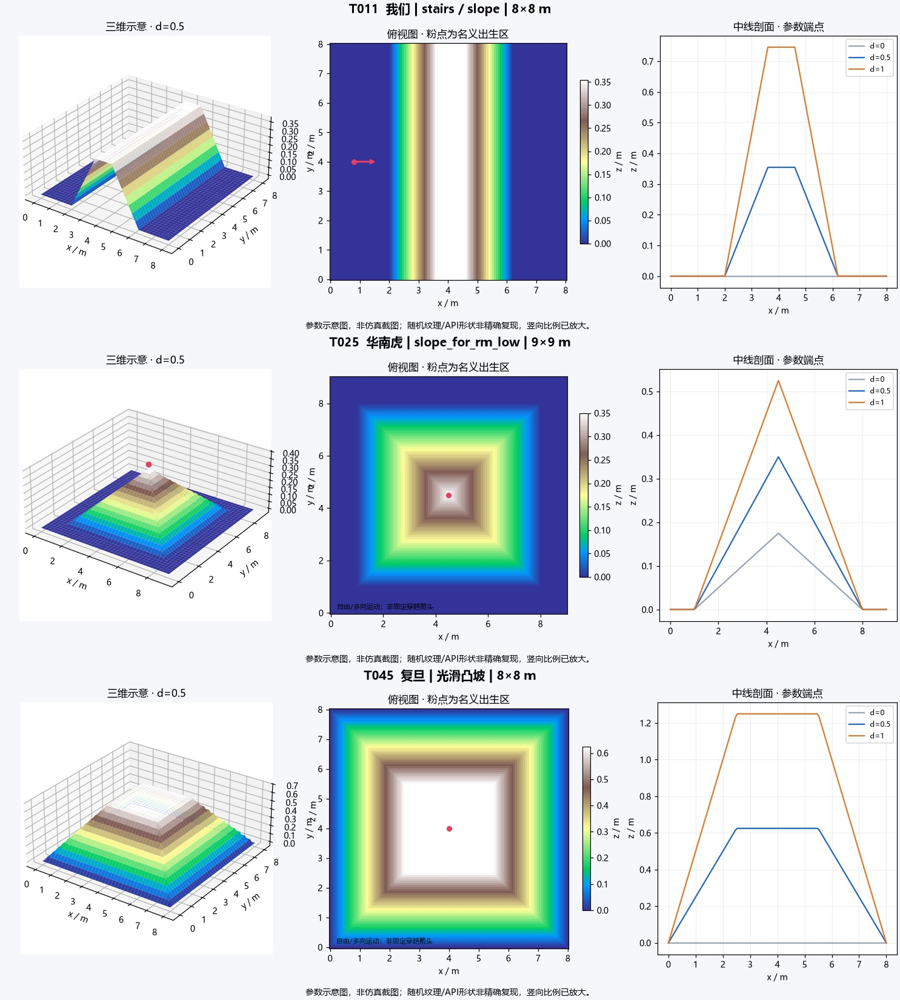

## 井字与离散障碍：复旦不是同款井字

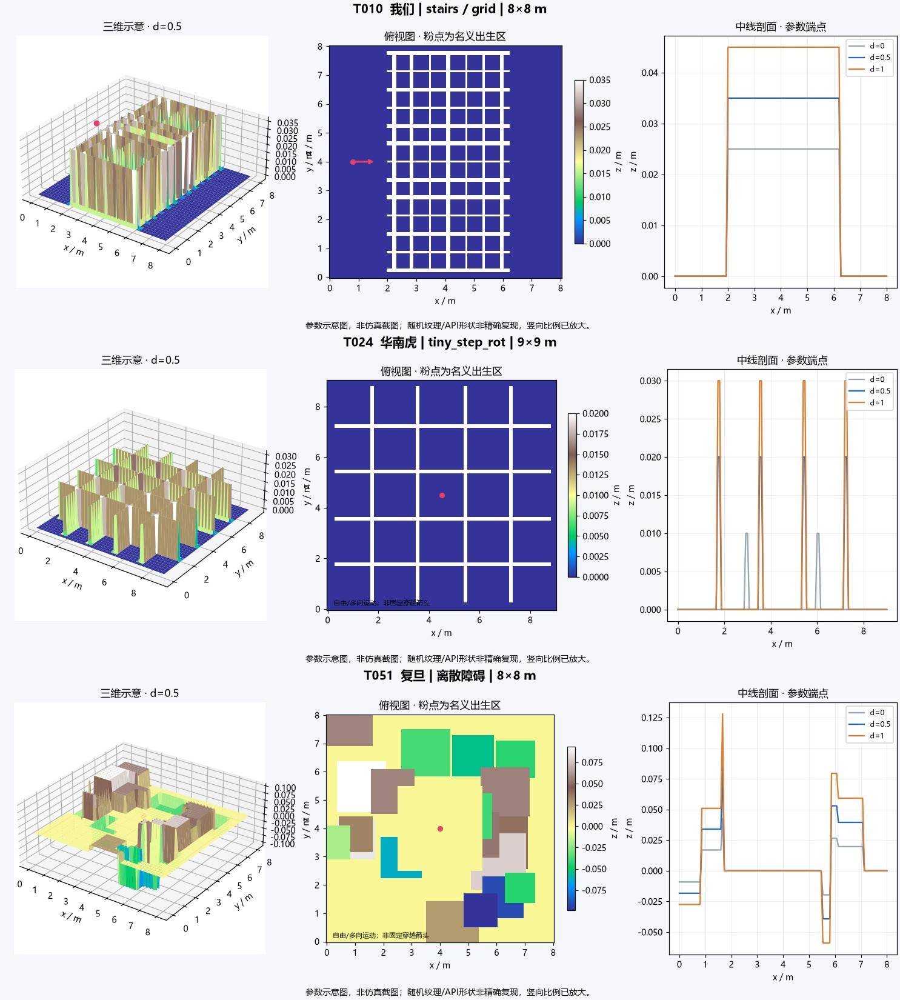

## T001 我们 / 无限平面

**说明：** 仅显示8×8米窗口，非有限地块

**使用配置：** p1-flat / p1-landing / p3-jump

**来源：** isaac/wheelleg_tasks/env_cfg.py

完整绘图参数

| 字段 | 原值 |
|---|---|
|  | {} |

## T002 我们 / stairs / flat

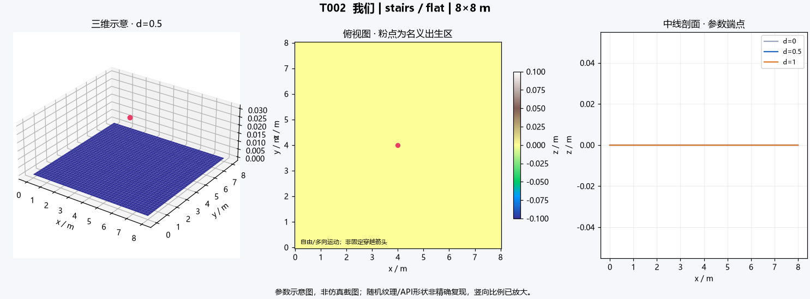

**说明：** 非平地从接近平台进入；平地从中心区域出生

**使用配置：** p1-stairs flat

**来源：** isaac/wheelleg_tasks/terrain.py:course_terrain

完整绘图参数

| 字段 | 原值 |
|---|---|
| profile.proportion | 0.3 |
| profile.kind | flat |
| profile.step_count | 0 |
| profile.speed_range_m_s | [0.0, 2.7] |
| profile.command_mode | motion |
| profile.heading_yaw_limit_rad_s | 1.0 |
| profile.yaw_range_rad_s | [-5.0, 5.0] |
| profile.height_range_m | [0.2, 0.43885688] |
| profile.start_speed_range_m_s | [0.0, 2.7] |
| geometry.tile_size_m | [8.0, 8.0] |
| geometry.rows | 8 |
| geometry.columns | 20 |
| geometry.step_height_range_m | [0.02, 0.24] |
| geometry.step_width_m | 0.8 |
| geometry.slope_angle_range_rad | [0.0, 0.4363323129985824] |
| geometry.rough_noise_range_m | [0.0, 0.03] |
| geometry.rough_noise_step_m | 0.005 |
| geometry.rough_downsampled_scale_m | 0.2 |
| geometry.heightfield_border_width_m | 1.0 |
| geometry.border_width_m | 5.0 |
| geometry.boundary_margin_m | 0.5 |
| geometry.spawn_x_m | 0.8 |
| geometry.entry_x_m | 2.4 |
| geometry.surface_x_range_m | [2.0, 6.2] |
| geometry.exit_x_m | 5.6 |
| geometry.finish_x_m | 6.6 |
| geometry.ground_thickness_m | 0.1 |
| geometry.seed | 42 |
| geometry.surface_resolution_m | 0.2 |
| geometry.grid.width_range_m | [0.08, 0.12] |
| geometry.grid.height_range_m | [0.025, 0.045] |
| geometry.grid.spacing_range_m | [0.55, 0.7] |
| geometry.grid.half_span_m | 3.8 |
| geometry.rough_proportion | 0.05 |

## T003 我们 / stairs / up_one

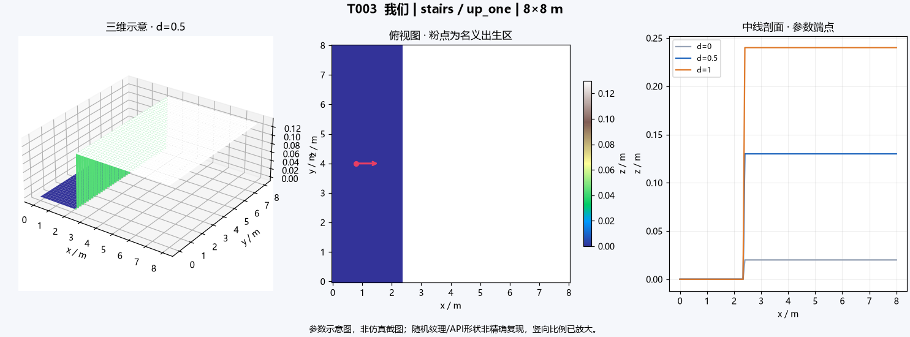

**说明：** 非平地从接近平台进入；平地从中心区域出生

**使用配置：** p1-stairs up_one

**来源：** isaac/wheelleg_tasks/terrain.py:course_terrain

完整绘图参数

| 字段 | 原值 |
|---|---|
| profile.proportion | 0.1 |
| profile.kind | up |
| profile.step_count | 1 |
| profile.speed_range_m_s | [0.5, 1.5] |
| profile.command_mode | traverse |
| profile.heading_yaw_limit_rad_s | 1.0 |
| profile.yaw_range_rad_s | [-0.1, 0.1] |
| profile.height_range_m | [0.22, 0.34] |
| profile.start_speed_range_m_s | [0.3, 0.6] |
| geometry.tile_size_m | [8.0, 8.0] |
| geometry.rows | 8 |
| geometry.columns | 20 |
| geometry.step_height_range_m | [0.02, 0.24] |
| geometry.step_width_m | 0.8 |
| geometry.slope_angle_range_rad | [0.0, 0.4363323129985824] |
| geometry.rough_noise_range_m | [0.0, 0.03] |
| geometry.rough_noise_step_m | 0.005 |
| geometry.rough_downsampled_scale_m | 0.2 |
| geometry.heightfield_border_width_m | 1.0 |
| geometry.border_width_m | 5.0 |
| geometry.boundary_margin_m | 0.5 |
| geometry.spawn_x_m | 0.8 |
| geometry.entry_x_m | 2.4 |
| geometry.surface_x_range_m | [2.0, 6.2] |
| geometry.exit_x_m | 5.6 |
| geometry.finish_x_m | 6.6 |
| geometry.ground_thickness_m | 0.1 |
| geometry.seed | 42 |
| geometry.surface_resolution_m | 0.2 |
| geometry.grid.width_range_m | [0.08, 0.12] |
| geometry.grid.height_range_m | [0.025, 0.045] |
| geometry.grid.spacing_range_m | [0.55, 0.7] |
| geometry.grid.half_span_m | 3.8 |
| geometry.rough_proportion | 0.05 |

## T004 我们 / stairs / down_one

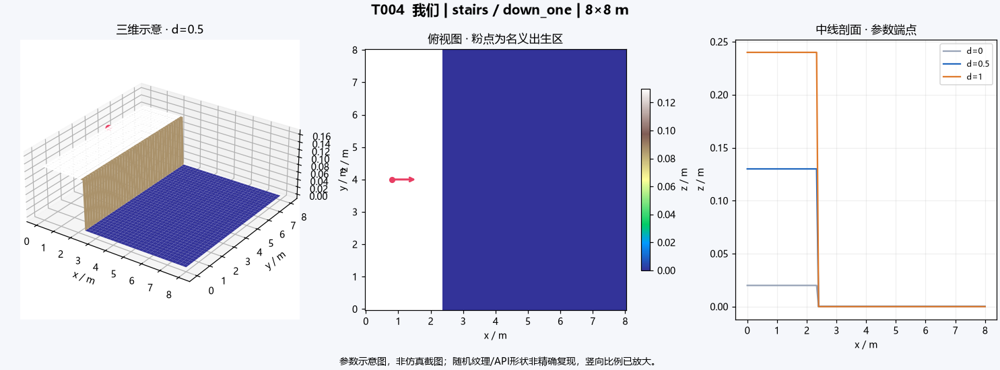

**说明：** 非平地从接近平台进入；平地从中心区域出生

**使用配置：** p1-stairs down_one

**来源：** isaac/wheelleg_tasks/terrain.py:course_terrain

完整绘图参数

| 字段 | 原值 |
|---|---|
| profile.proportion | 0.1 |
| profile.kind | down |
| profile.step_count | 1 |
| profile.speed_range_m_s | [0.5, 1.5] |
| profile.command_mode | traverse |
| profile.heading_yaw_limit_rad_s | 1.0 |
| profile.yaw_range_rad_s | [-0.1, 0.1] |
| profile.height_range_m | [0.22, 0.34] |
| profile.start_speed_range_m_s | [0.3, 0.6] |
| geometry.tile_size_m | [8.0, 8.0] |
| geometry.rows | 8 |
| geometry.columns | 20 |
| geometry.step_height_range_m | [0.02, 0.24] |
| geometry.step_width_m | 0.8 |
| geometry.slope_angle_range_rad | [0.0, 0.4363323129985824] |
| geometry.rough_noise_range_m | [0.0, 0.03] |
| geometry.rough_noise_step_m | 0.005 |
| geometry.rough_downsampled_scale_m | 0.2 |
| geometry.heightfield_border_width_m | 1.0 |
| geometry.border_width_m | 5.0 |
| geometry.boundary_margin_m | 0.5 |
| geometry.spawn_x_m | 0.8 |
| geometry.entry_x_m | 2.4 |
| geometry.surface_x_range_m | [2.0, 6.2] |
| geometry.exit_x_m | 5.6 |
| geometry.finish_x_m | 6.6 |
| geometry.ground_thickness_m | 0.1 |
| geometry.seed | 42 |
| geometry.surface_resolution_m | 0.2 |
| geometry.grid.width_range_m | [0.08, 0.12] |
| geometry.grid.height_range_m | [0.025, 0.045] |
| geometry.grid.spacing_range_m | [0.55, 0.7] |
| geometry.grid.half_span_m | 3.8 |
| geometry.rough_proportion | 0.05 |

## T005 我们 / stairs / mixed_one

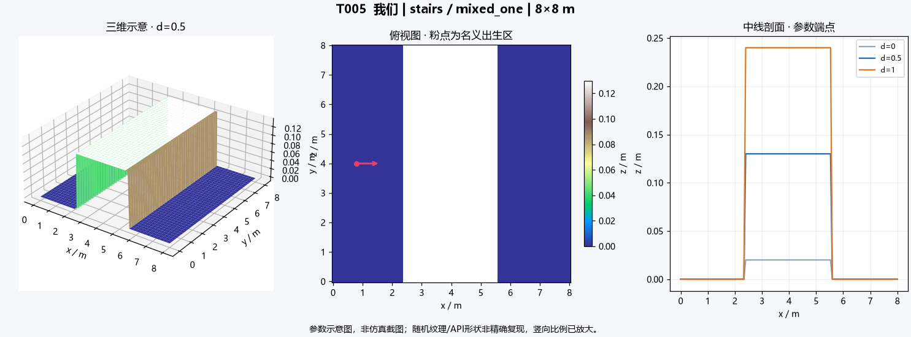

**说明：** 非平地从接近平台进入；平地从中心区域出生

**使用配置：** p1-stairs mixed_one

**来源：** isaac/wheelleg_tasks/terrain.py:course_terrain

完整绘图参数

| 字段 | 原值 |
|---|---|
| profile.proportion | 0.05 |
| profile.kind | mixed |
| profile.step_count | 1 |
| profile.speed_range_m_s | [0.5, 1.5] |
| profile.command_mode | traverse |
| profile.heading_yaw_limit_rad_s | 1.0 |
| profile.yaw_range_rad_s | [-0.1, 0.1] |
| profile.height_range_m | [0.22, 0.34] |
| profile.start_speed_range_m_s | [0.3, 0.6] |
| geometry.tile_size_m | [8.0, 8.0] |
| geometry.rows | 8 |
| geometry.columns | 20 |
| geometry.step_height_range_m | [0.02, 0.24] |
| geometry.step_width_m | 0.8 |
| geometry.slope_angle_range_rad | [0.0, 0.4363323129985824] |
| geometry.rough_noise_range_m | [0.0, 0.03] |
| geometry.rough_noise_step_m | 0.005 |
| geometry.rough_downsampled_scale_m | 0.2 |
| geometry.heightfield_border_width_m | 1.0 |
| geometry.border_width_m | 5.0 |
| geometry.boundary_margin_m | 0.5 |
| geometry.spawn_x_m | 0.8 |
| geometry.entry_x_m | 2.4 |
| geometry.surface_x_range_m | [2.0, 6.2] |
| geometry.exit_x_m | 5.6 |
| geometry.finish_x_m | 6.6 |
| geometry.ground_thickness_m | 0.1 |
| geometry.seed | 42 |
| geometry.surface_resolution_m | 0.2 |
| geometry.grid.width_range_m | [0.08, 0.12] |
| geometry.grid.height_range_m | [0.025, 0.045] |
| geometry.grid.spacing_range_m | [0.55, 0.7] |
| geometry.grid.half_span_m | 3.8 |
| geometry.rough_proportion | 0.05 |

## T006 我们 / stairs / mixed_fast

**说明：** 非平地从接近平台进入；平地从中心区域出生

**使用配置：** p1-stairs mixed_fast

**来源：** isaac/wheelleg_tasks/terrain.py:course_terrain

完整绘图参数

| 字段 | 原值 |
|---|---|
| profile.proportion | 0.05 |
| profile.kind | mixed |
| profile.step_count | 1 |
| profile.speed_range_m_s | [1.5, 2.7] |
| profile.command_mode | traverse |
| profile.heading_yaw_limit_rad_s | 1.0 |
| profile.yaw_range_rad_s | [-0.1, 0.1] |
| profile.height_range_m | [0.22, 0.34] |
| profile.start_speed_range_m_s | [0.6, 1.0] |
| geometry.tile_size_m | [8.0, 8.0] |
| geometry.rows | 8 |
| geometry.columns | 20 |
| geometry.step_height_range_m | [0.02, 0.24] |
| geometry.step_width_m | 0.8 |
| geometry.slope_angle_range_rad | [0.0, 0.4363323129985824] |
| geometry.rough_noise_range_m | [0.0, 0.03] |
| geometry.rough_noise_step_m | 0.005 |
| geometry.rough_downsampled_scale_m | 0.2 |
| geometry.heightfield_border_width_m | 1.0 |
| geometry.border_width_m | 5.0 |
| geometry.boundary_margin_m | 0.5 |
| geometry.spawn_x_m | 0.8 |
| geometry.entry_x_m | 2.4 |
| geometry.surface_x_range_m | [2.0, 6.2] |
| geometry.exit_x_m | 5.6 |
| geometry.finish_x_m | 6.6 |
| geometry.ground_thickness_m | 0.1 |
| geometry.seed | 42 |
| geometry.surface_resolution_m | 0.2 |
| geometry.grid.width_range_m | [0.08, 0.12] |
| geometry.grid.height_range_m | [0.025, 0.045] |
| geometry.grid.spacing_range_m | [0.55, 0.7] |
| geometry.grid.half_span_m | 3.8 |
| geometry.rough_proportion | 0.05 |

## T007 我们 / stairs / up_two

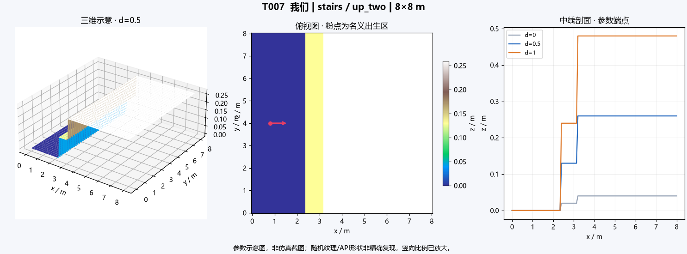

**说明：** 非平地从接近平台进入；平地从中心区域出生

**使用配置：** p1-stairs up_two

**来源：** isaac/wheelleg_tasks/terrain.py:course_terrain

完整绘图参数

| 字段 | 原值 |
|---|---|
| profile.proportion | 0.05 |
| profile.kind | up |
| profile.step_count | 2 |
| profile.speed_range_m_s | [0.5, 1.5] |
| profile.command_mode | traverse |
| profile.heading_yaw_limit_rad_s | 1.0 |
| profile.yaw_range_rad_s | [-0.1, 0.1] |
| profile.height_range_m | [0.22, 0.34] |
| profile.start_speed_range_m_s | [0.3, 0.6] |
| geometry.tile_size_m | [8.0, 8.0] |
| geometry.rows | 8 |
| geometry.columns | 20 |
| geometry.step_height_range_m | [0.02, 0.24] |
| geometry.step_width_m | 0.8 |
| geometry.slope_angle_range_rad | [0.0, 0.4363323129985824] |
| geometry.rough_noise_range_m | [0.0, 0.03] |
| geometry.rough_noise_step_m | 0.005 |
| geometry.rough_downsampled_scale_m | 0.2 |
| geometry.heightfield_border_width_m | 1.0 |
| geometry.border_width_m | 5.0 |
| geometry.boundary_margin_m | 0.5 |
| geometry.spawn_x_m | 0.8 |
| geometry.entry_x_m | 2.4 |
| geometry.surface_x_range_m | [2.0, 6.2] |
| geometry.exit_x_m | 5.6 |
| geometry.finish_x_m | 6.6 |
| geometry.ground_thickness_m | 0.1 |
| geometry.seed | 42 |
| geometry.surface_resolution_m | 0.2 |
| geometry.grid.width_range_m | [0.08, 0.12] |
| geometry.grid.height_range_m | [0.025, 0.045] |
| geometry.grid.spacing_range_m | [0.55, 0.7] |
| geometry.grid.half_span_m | 3.8 |
| geometry.rough_proportion | 0.05 |

## T008 我们 / stairs / down_two

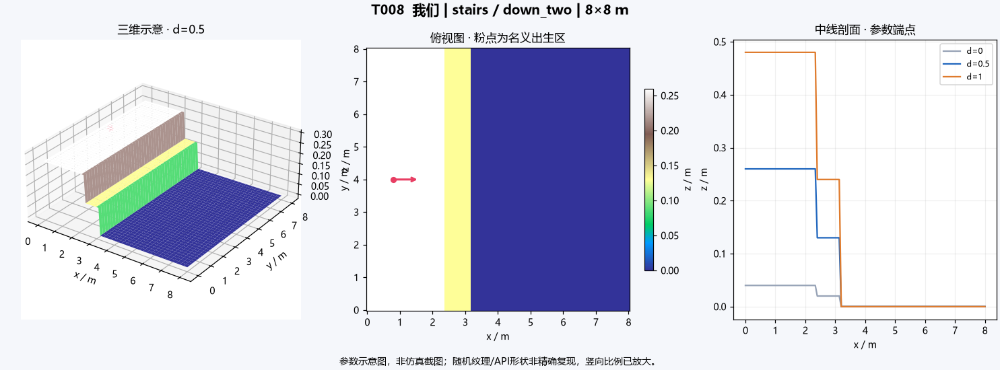

**说明：** 非平地从接近平台进入；平地从中心区域出生

**使用配置：** p1-stairs down_two

**来源：** isaac/wheelleg_tasks/terrain.py:course_terrain

完整绘图参数

| 字段 | 原值 |
|---|---|
| profile.proportion | 0.05 |
| profile.kind | down |
| profile.step_count | 2 |
| profile.speed_range_m_s | [0.5, 1.5] |
| profile.command_mode | traverse |
| profile.heading_yaw_limit_rad_s | 1.0 |
| profile.yaw_range_rad_s | [-0.1, 0.1] |
| profile.height_range_m | [0.22, 0.34] |
| profile.start_speed_range_m_s | [0.3, 0.6] |
| geometry.tile_size_m | [8.0, 8.0] |
| geometry.rows | 8 |
| geometry.columns | 20 |
| geometry.step_height_range_m | [0.02, 0.24] |
| geometry.step_width_m | 0.8 |
| geometry.slope_angle_range_rad | [0.0, 0.4363323129985824] |
| geometry.rough_noise_range_m | [0.0, 0.03] |
| geometry.rough_noise_step_m | 0.005 |
| geometry.rough_downsampled_scale_m | 0.2 |
| geometry.heightfield_border_width_m | 1.0 |
| geometry.border_width_m | 5.0 |
| geometry.boundary_margin_m | 0.5 |
| geometry.spawn_x_m | 0.8 |
| geometry.entry_x_m | 2.4 |
| geometry.surface_x_range_m | [2.0, 6.2] |
| geometry.exit_x_m | 5.6 |
| geometry.finish_x_m | 6.6 |
| geometry.ground_thickness_m | 0.1 |
| geometry.seed | 42 |
| geometry.surface_resolution_m | 0.2 |
| geometry.grid.width_range_m | [0.08, 0.12] |
| geometry.grid.height_range_m | [0.025, 0.045] |
| geometry.grid.spacing_range_m | [0.55, 0.7] |
| geometry.grid.half_span_m | 3.8 |
| geometry.rough_proportion | 0.05 |

## T009 我们 / stairs / mixed_two

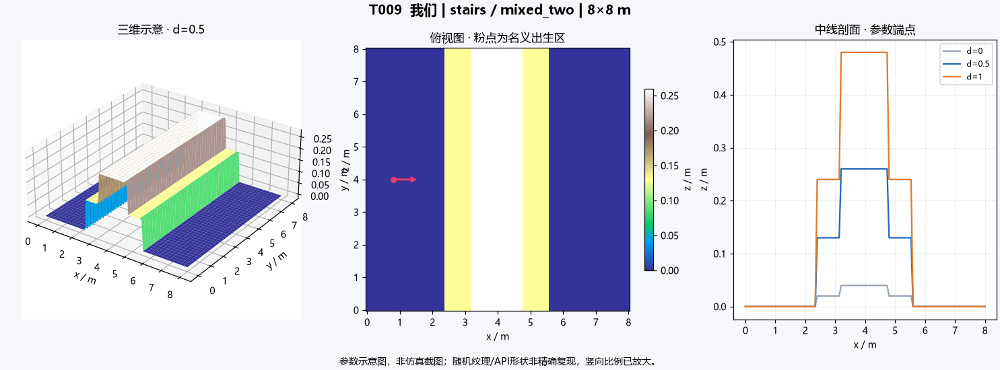

**说明：** 非平地从接近平台进入；平地从中心区域出生

**使用配置：** p1-stairs mixed_two

**来源：** isaac/wheelleg_tasks/terrain.py:course_terrain

完整绘图参数

| 字段 | 原值 |
|---|---|
| profile.proportion | 0.1 |
| profile.kind | mixed |
| profile.step_count | 2 |
| profile.speed_range_m_s | [0.5, 1.5] |
| profile.command_mode | traverse |
| profile.heading_yaw_limit_rad_s | 1.0 |
| profile.yaw_range_rad_s | [-0.1, 0.1] |
| profile.height_range_m | [0.22, 0.34] |
| profile.start_speed_range_m_s | [0.3, 0.6] |
| geometry.tile_size_m | [8.0, 8.0] |
| geometry.rows | 8 |
| geometry.columns | 20 |
| geometry.step_height_range_m | [0.02, 0.24] |
| geometry.step_width_m | 0.8 |
| geometry.slope_angle_range_rad | [0.0, 0.4363323129985824] |
| geometry.rough_noise_range_m | [0.0, 0.03] |
| geometry.rough_noise_step_m | 0.005 |
| geometry.rough_downsampled_scale_m | 0.2 |
| geometry.heightfield_border_width_m | 1.0 |
| geometry.border_width_m | 5.0 |
| geometry.boundary_margin_m | 0.5 |
| geometry.spawn_x_m | 0.8 |
| geometry.entry_x_m | 2.4 |
| geometry.surface_x_range_m | [2.0, 6.2] |
| geometry.exit_x_m | 5.6 |
| geometry.finish_x_m | 6.6 |
| geometry.ground_thickness_m | 0.1 |
| geometry.seed | 42 |
| geometry.surface_resolution_m | 0.2 |
| geometry.grid.width_range_m | [0.08, 0.12] |
| geometry.grid.height_range_m | [0.025, 0.045] |
| geometry.grid.spacing_range_m | [0.55, 0.7] |
| geometry.grid.half_span_m | 3.8 |
| geometry.rough_proportion | 0.05 |

## T010 我们 / stairs / grid

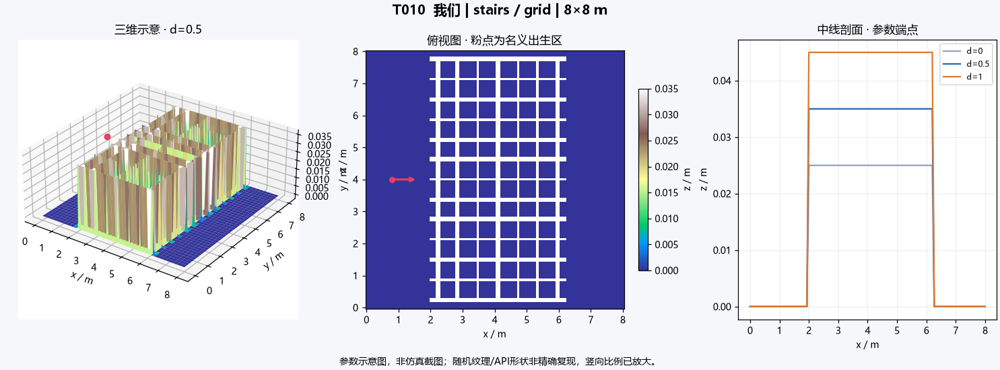

**说明：** 非平地从接近平台进入；平地从中心区域出生

**使用配置：** p1-stairs grid

**来源：** isaac/wheelleg_tasks/terrain.py:course_terrain

完整绘图参数

| 字段 | 原值 |
|---|---|
| profile.proportion | 0.1 |
| profile.kind | grid |
| profile.step_count | 0 |
| profile.speed_range_m_s | [0.3, 1.2] |
| profile.command_mode | free |
| profile.free_yaw_limit_range_rad_s | [0.5, 2.0] |
| profile.heading_yaw_limit_rad_s | 0.5 |
| profile.yaw_range_rad_s | [-0.3, 0.3] |
| profile.height_range_m | [0.22, 0.38] |
| profile.start_speed_range_m_s | [0.25, 0.5] |
| geometry.tile_size_m | [8.0, 8.0] |
| geometry.rows | 8 |
| geometry.columns | 20 |
| geometry.step_height_range_m | [0.02, 0.24] |
| geometry.step_width_m | 0.8 |
| geometry.slope_angle_range_rad | [0.0, 0.4363323129985824] |
| geometry.rough_noise_range_m | [0.0, 0.03] |
| geometry.rough_noise_step_m | 0.005 |
| geometry.rough_downsampled_scale_m | 0.2 |
| geometry.heightfield_border_width_m | 1.0 |
| geometry.border_width_m | 5.0 |
| geometry.boundary_margin_m | 0.5 |
| geometry.spawn_x_m | 0.8 |
| geometry.entry_x_m | 2.4 |
| geometry.surface_x_range_m | [2.0, 6.2] |
| geometry.exit_x_m | 5.6 |
| geometry.finish_x_m | 6.6 |
| geometry.ground_thickness_m | 0.1 |
| geometry.seed | 42 |
| geometry.surface_resolution_m | 0.2 |
| geometry.grid.width_range_m | [0.08, 0.12] |
| geometry.grid.height_range_m | [0.025, 0.045] |
| geometry.grid.spacing_range_m | [0.55, 0.7] |
| geometry.grid.half_span_m | 3.8 |
| geometry.rough_proportion | 0.05 |

## T011 我们 / stairs / slope

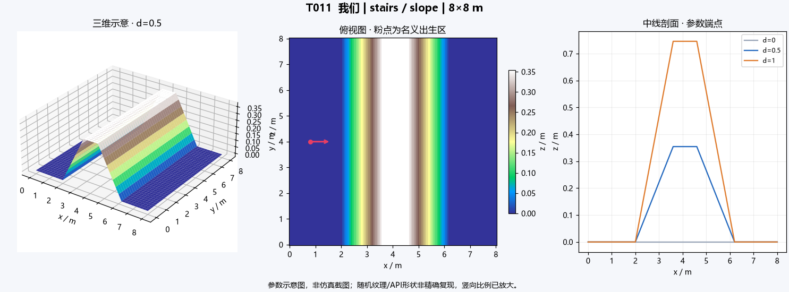

**说明：** 非平地从接近平台进入；平地从中心区域出生

**使用配置：** p1-stairs slope

**来源：** isaac/wheelleg_tasks/terrain.py:course_terrain

完整绘图参数

| 字段 | 原值 |
|---|---|
| profile.proportion | 0.05 |
| profile.kind | slope |
| profile.step_count | 0 |
| profile.speed_range_m_s | [0.4, 1.5] |
| profile.command_mode | traverse |
| profile.heading_yaw_limit_rad_s | 0.5 |
| profile.yaw_range_rad_s | [-0.1, 0.1] |
| profile.height_range_m | [0.24, 0.34] |
| profile.start_speed_range_m_s | [0.25, 0.6] |
| geometry.tile_size_m | [8.0, 8.0] |
| geometry.rows | 8 |
| geometry.columns | 20 |
| geometry.step_height_range_m | [0.02, 0.24] |
| geometry.step_width_m | 0.8 |
| geometry.slope_angle_range_rad | [0.0, 0.4363323129985824] |
| geometry.rough_noise_range_m | [0.0, 0.03] |
| geometry.rough_noise_step_m | 0.005 |
| geometry.rough_downsampled_scale_m | 0.2 |
| geometry.heightfield_border_width_m | 1.0 |
| geometry.border_width_m | 5.0 |
| geometry.boundary_margin_m | 0.5 |
| geometry.spawn_x_m | 0.8 |
| geometry.entry_x_m | 2.4 |
| geometry.surface_x_range_m | [2.0, 6.2] |
| geometry.exit_x_m | 5.6 |
| geometry.finish_x_m | 6.6 |
| geometry.ground_thickness_m | 0.1 |
| geometry.seed | 42 |
| geometry.surface_resolution_m | 0.2 |
| geometry.grid.width_range_m | [0.08, 0.12] |
| geometry.grid.height_range_m | [0.025, 0.045] |
| geometry.grid.spacing_range_m | [0.55, 0.7] |
| geometry.grid.half_span_m | 3.8 |
| geometry.rough_proportion | 0.05 |

## T012 我们 / stairs / rough

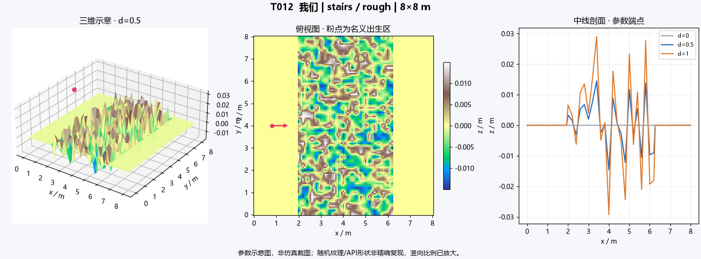

**说明：** 非平地从接近平台进入；平地从中心区域出生

**使用配置：** p1-stairs rough

**来源：** isaac/wheelleg_tasks/terrain.py:course_terrain

完整绘图参数

| 字段 | 原值 |
|---|---|
| profile.proportion | 0.05 |
| profile.kind | rough |
| profile.step_count | 0 |
| profile.speed_range_m_s | [0.3, 1.5] |
| profile.command_mode | free |
| profile.free_yaw_limit_range_rad_s | [0.5, 2.0] |
| profile.heading_yaw_limit_rad_s | 0.5 |
| profile.yaw_range_rad_s | [-0.3, 0.3] |
| profile.height_range_m | [0.22, 0.38] |
| profile.start_speed_range_m_s | [0.25, 0.5] |
| geometry.tile_size_m | [8.0, 8.0] |
| geometry.rows | 8 |
| geometry.columns | 20 |
| geometry.step_height_range_m | [0.02, 0.24] |
| geometry.step_width_m | 0.8 |
| geometry.slope_angle_range_rad | [0.0, 0.4363323129985824] |
| geometry.rough_noise_range_m | [0.0, 0.03] |
| geometry.rough_noise_step_m | 0.005 |
| geometry.rough_downsampled_scale_m | 0.2 |
| geometry.heightfield_border_width_m | 1.0 |
| geometry.border_width_m | 5.0 |
| geometry.boundary_margin_m | 0.5 |
| geometry.spawn_x_m | 0.8 |
| geometry.entry_x_m | 2.4 |
| geometry.surface_x_range_m | [2.0, 6.2] |
| geometry.exit_x_m | 5.6 |
| geometry.finish_x_m | 6.6 |
| geometry.ground_thickness_m | 0.1 |
| geometry.seed | 42 |
| geometry.surface_resolution_m | 0.2 |
| geometry.grid.width_range_m | [0.08, 0.12] |
| geometry.grid.height_range_m | [0.025, 0.045] |
| geometry.grid.spacing_range_m | [0.55, 0.7] |
| geometry.grid.half_span_m | 3.8 |
| geometry.rough_proportion | 0.05 |

## T013 我们 / recovery / flat

**说明：** 内置Hf粗糙仅画类型示意

**使用配置：** p1-recovery flat

**来源：** isaac/wheelleg_tasks/terrain.py

完整绘图参数

| 字段 | 原值 |
|---|---|
| tile_size_m | [8.0, 8.0] |
| rows | 8 |
| columns | 10 |
| flat_proportion | 0.3 |
| step_height_range_m | [0.02, 0.24] |
| step_width_m | 0.8 |
| slope_proportion | 0.1 |
| bump_proportion | 0.1 |
| slope_angle_range_rad | [0.0, 0.4363323129985824] |
| bump_height_range_m | [0.01, 0.07] |
| bump_spacing_m | 0.24 |
| bump_width_m | 0.12 |
| rough_proportion | 0.1 |
| rough_noise_range_m | [0.0, 0.03] |
| rough_noise_step_m | 0.005 |
| rough_downsampled_scale_m | 0.2 |
| heightfield_border_width_m | 1.0 |
| border_width_m | 5.0 |
| boundary_margin_m | 0.5 |

## T014 我们 / recovery / one

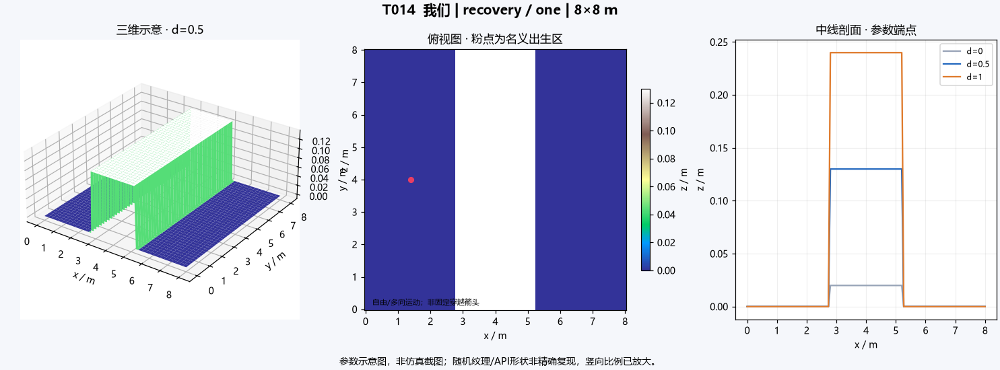

**说明：** 内置Hf粗糙仅画类型示意

**使用配置：** p1-recovery one

**来源：** isaac/wheelleg_tasks/terrain.py

完整绘图参数

| 字段 | 原值 |
|---|---|
| tile_size_m | [8.0, 8.0] |
| rows | 8 |
| columns | 10 |
| flat_proportion | 0.3 |
| step_height_range_m | [0.02, 0.24] |
| step_width_m | 0.8 |
| slope_proportion | 0.1 |
| bump_proportion | 0.1 |
| slope_angle_range_rad | [0.0, 0.4363323129985824] |
| bump_height_range_m | [0.01, 0.07] |
| bump_spacing_m | 0.24 |
| bump_width_m | 0.12 |
| rough_proportion | 0.1 |
| rough_noise_range_m | [0.0, 0.03] |
| rough_noise_step_m | 0.005 |
| rough_downsampled_scale_m | 0.2 |
| heightfield_border_width_m | 1.0 |
| border_width_m | 5.0 |
| boundary_margin_m | 0.5 |

## T015 我们 / recovery / two

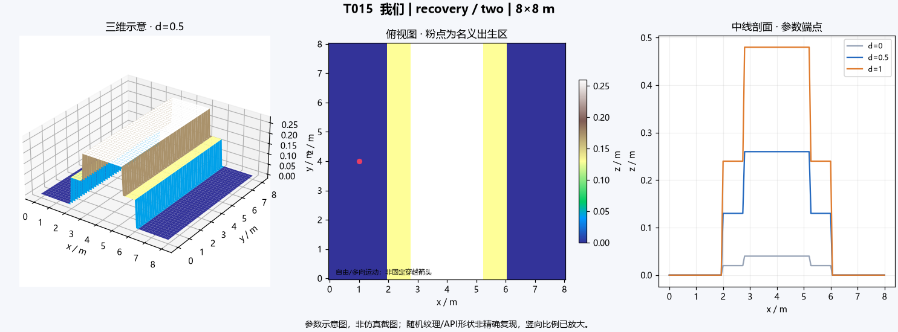

**说明：** 内置Hf粗糙仅画类型示意

**使用配置：** p1-recovery two

**来源：** isaac/wheelleg_tasks/terrain.py

完整绘图参数

| 字段 | 原值 |
|---|---|
| tile_size_m | [8.0, 8.0] |
| rows | 8 |
| columns | 10 |
| flat_proportion | 0.3 |
| step_height_range_m | [0.02, 0.24] |
| step_width_m | 0.8 |
| slope_proportion | 0.1 |
| bump_proportion | 0.1 |
| slope_angle_range_rad | [0.0, 0.4363323129985824] |
| bump_height_range_m | [0.01, 0.07] |
| bump_spacing_m | 0.24 |
| bump_width_m | 0.12 |
| rough_proportion | 0.1 |
| rough_noise_range_m | [0.0, 0.03] |
| rough_noise_step_m | 0.005 |
| rough_downsampled_scale_m | 0.2 |
| heightfield_border_width_m | 1.0 |
| border_width_m | 5.0 |
| boundary_margin_m | 0.5 |

## T016 我们 / recovery / slope

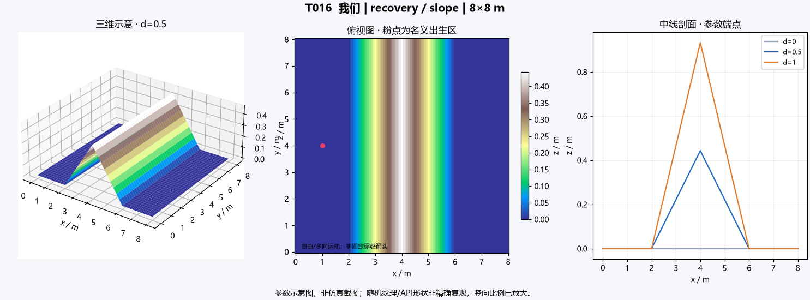

**说明：** 内置Hf粗糙仅画类型示意

**使用配置：** p1-recovery slope

**来源：** isaac/wheelleg_tasks/terrain.py

完整绘图参数

| 字段 | 原值 |
|---|---|
| tile_size_m | [8.0, 8.0] |
| rows | 8 |
| columns | 10 |
| flat_proportion | 0.3 |
| step_height_range_m | [0.02, 0.24] |
| step_width_m | 0.8 |
| slope_proportion | 0.1 |
| bump_proportion | 0.1 |
| slope_angle_range_rad | [0.0, 0.4363323129985824] |
| bump_height_range_m | [0.01, 0.07] |
| bump_spacing_m | 0.24 |
| bump_width_m | 0.12 |
| rough_proportion | 0.1 |
| rough_noise_range_m | [0.0, 0.03] |
| rough_noise_step_m | 0.005 |
| rough_downsampled_scale_m | 0.2 |
| heightfield_border_width_m | 1.0 |
| border_width_m | 5.0 |
| boundary_margin_m | 0.5 |

## T017 我们 / recovery / bumps

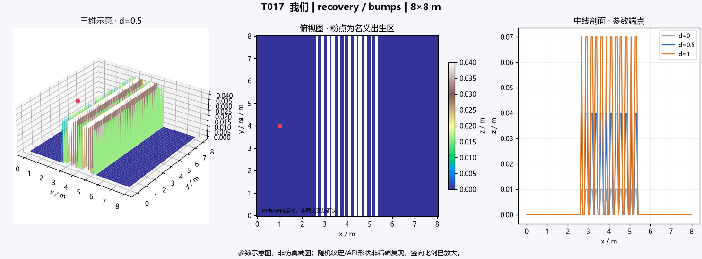

**说明：** 内置Hf粗糙仅画类型示意

**使用配置：** p1-recovery bumps

**来源：** isaac/wheelleg_tasks/terrain.py

完整绘图参数

| 字段 | 原值 |
|---|---|
| tile_size_m | [8.0, 8.0] |
| rows | 8 |
| columns | 10 |
| flat_proportion | 0.3 |
| step_height_range_m | [0.02, 0.24] |
| step_width_m | 0.8 |
| slope_proportion | 0.1 |
| bump_proportion | 0.1 |
| slope_angle_range_rad | [0.0, 0.4363323129985824] |
| bump_height_range_m | [0.01, 0.07] |
| bump_spacing_m | 0.24 |
| bump_width_m | 0.12 |
| rough_proportion | 0.1 |
| rough_noise_range_m | [0.0, 0.03] |
| rough_noise_step_m | 0.005 |
| rough_downsampled_scale_m | 0.2 |
| heightfield_border_width_m | 1.0 |
| border_width_m | 5.0 |
| boundary_margin_m | 0.5 |

## T018 我们 / recovery / rough

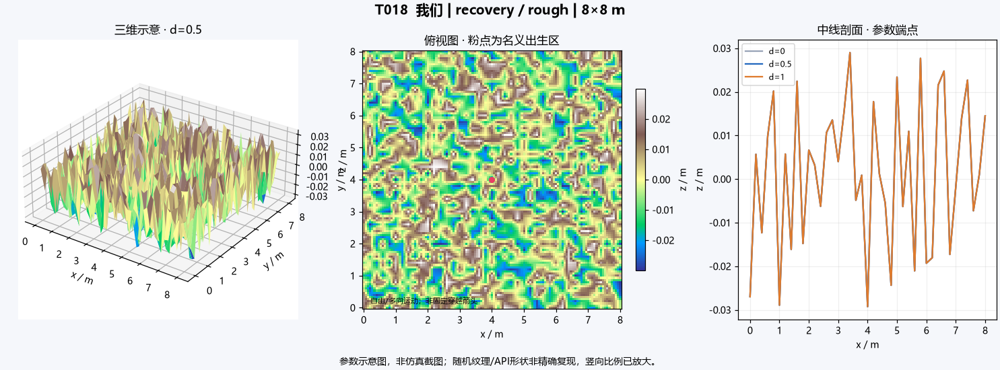

**说明：** 内置Hf粗糙仅画类型示意

**使用配置：** p1-recovery rough

**来源：** isaac/wheelleg_tasks/terrain.py

完整绘图参数

| 字段 | 原值 |
|---|---|
| tile_size_m | [8.0, 8.0] |
| rows | 8 |
| columns | 10 |
| flat_proportion | 0.3 |
| step_height_range_m | [0.02, 0.24] |
| step_width_m | 0.8 |
| slope_proportion | 0.1 |
| bump_proportion | 0.1 |
| slope_angle_range_rad | [0.0, 0.4363323129985824] |
| bump_height_range_m | [0.01, 0.07] |
| bump_spacing_m | 0.24 |
| bump_width_m | 0.12 |
| rough_proportion | 0.1 |
| rough_noise_range_m | [0.0, 0.03] |
| rough_noise_step_m | 0.005 |
| rough_downsampled_scale_m | 0.2 |
| heightfield_border_width_m | 1.0 |
| border_width_m | 5.0 |
| boundary_margin_m | 0.5 |

## T019 我们 / spin / flat

**说明：** 坡道出生在坡面；rough为类型示意

**使用配置：** p2-spin flat

**来源：** isaac/wheelleg_tasks/env_cfg.py

完整绘图参数

| 字段 | 原值 |
|---|---|
| tile_size_m | [9.0, 9.0] |
| rows | 8 |
| columns | 10 |
| difficulty_range | [0.0, 1.0] |
| flat_proportion | 0.5 |
| rough_proportion | 0.3 |
| slope_proportion | 0.2 |
| rough_noise_range_m | [0.0, 0.03] |
| rough_noise_step_m | 0.005 |
| rough_downsampled_scale_m | 0.2 |
| heightfield_border_width_m | 1.0 |
| border_width_m | 5.0 |
| boundary_margin_m | 0.5 |
| slope_angle_range_rad | [-0.1, 0.1] |

## T020 我们 / spin / slope

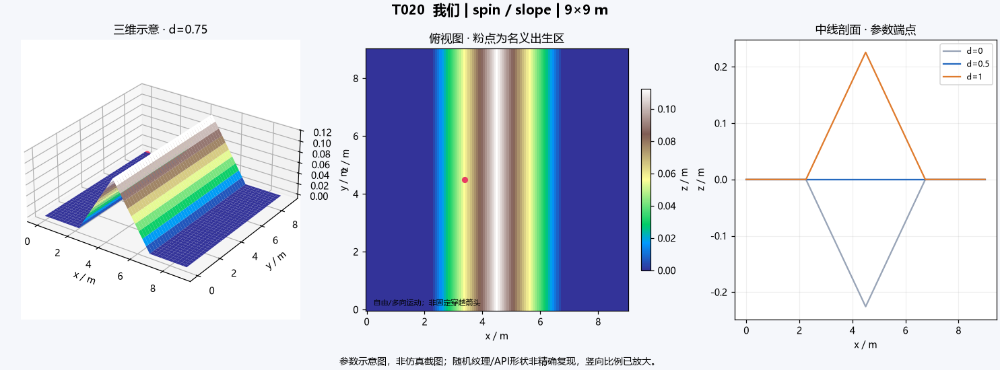

**说明：** 坡道出生在坡面；rough为类型示意

**使用配置：** p2-spin slope

**来源：** isaac/wheelleg_tasks/env_cfg.py

完整绘图参数

| 字段 | 原值 |
|---|---|
| tile_size_m | [9.0, 9.0] |
| rows | 8 |
| columns | 10 |
| difficulty_range | [0.0, 1.0] |
| flat_proportion | 0.5 |
| rough_proportion | 0.3 |
| slope_proportion | 0.2 |
| rough_noise_range_m | [0.0, 0.03] |
| rough_noise_step_m | 0.005 |
| rough_downsampled_scale_m | 0.2 |
| heightfield_border_width_m | 1.0 |
| border_width_m | 5.0 |
| boundary_margin_m | 0.5 |
| slope_angle_range_rad | [-0.1, 0.1] |

## T021 我们 / spin / rough

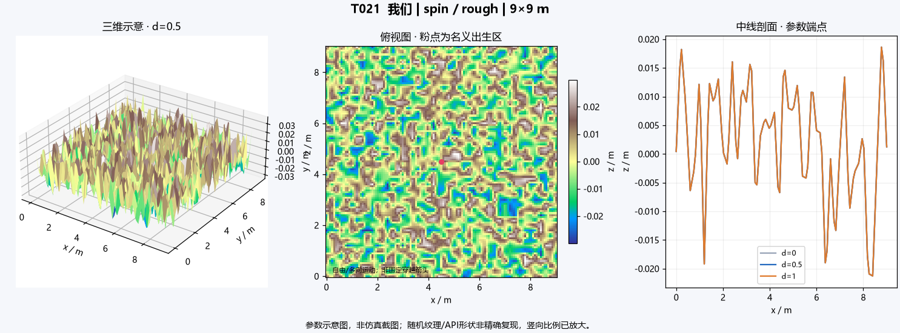

**说明：** 坡道出生在坡面；rough为类型示意

**使用配置：** p2-spin rough

**来源：** isaac/wheelleg_tasks/env_cfg.py

完整绘图参数

| 字段 | 原值 |
|---|---|
| tile_size_m | [9.0, 9.0] |
| rows | 8 |
| columns | 10 |
| difficulty_range | [0.0, 1.0] |
| flat_proportion | 0.5 |
| rough_proportion | 0.3 |
| slope_proportion | 0.2 |
| rough_noise_range_m | [0.0, 0.03] |
| rough_noise_step_m | 0.005 |
| rough_downsampled_scale_m | 0.2 |
| heightfield_border_width_m | 1.0 |
| border_width_m | 5.0 |
| boundary_margin_m | 0.5 |
| slope_angle_range_rad | [-0.1, 0.1] |

## T022 我们 / 跳隧道横梁及护栏

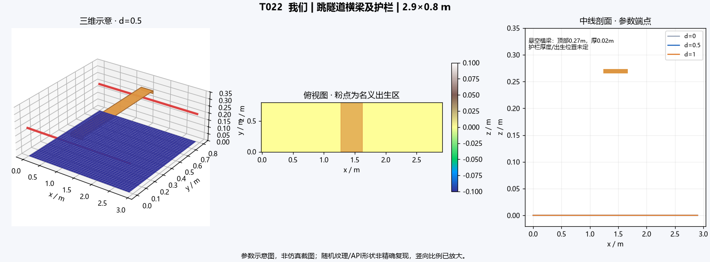

**说明：** 横梁x仅为排版；接近距离、护栏厚度待定，故不画出生点

**使用配置：** p3-tunnel

**来源：** isaac/wheelleg_tasks/env.py

完整绘图参数

| 字段 | 原值 |
|---|---|
| vx_range_m_s | null（未配置/待填） |
| beam_height_m | 0.27 |
| beam_length_m | 0.35 |
| beam_thickness_m | 0.02 |
| no_jump_beam_pose | [0.0, 0.0, -1.0, 1.0, 0.0, 0.0, 0.0] |
| lane_width_m | 0.8 |
| rail_height_m | 0.2 |
| lane_length_m | 2.9 |
| rail_thickness_m | null（未配置/待填） |
| approach_distance_m | null（未配置/待填） |
| trigger_distance_m | null（未配置/待填） |
| height_curriculum_m | [0.1, 0.15, 0.2, 0.27, 0.3] |
| clearance_margin_m | 0.03 |
| landing_margin_m | 0.05 |
| initial_yaw_range_rad | [-0.0872664626, 0.0872664626] |
| crossing_weight | 5.0 |
| obstacle_contact_weight | -5.0 |
| top_contact_weight | -10.0 |
| approach_jitter_m | null（未配置/待填） |
| height_jitter_m | [-0.01, 0.01] |

## T023 华南虎 / 无限平面

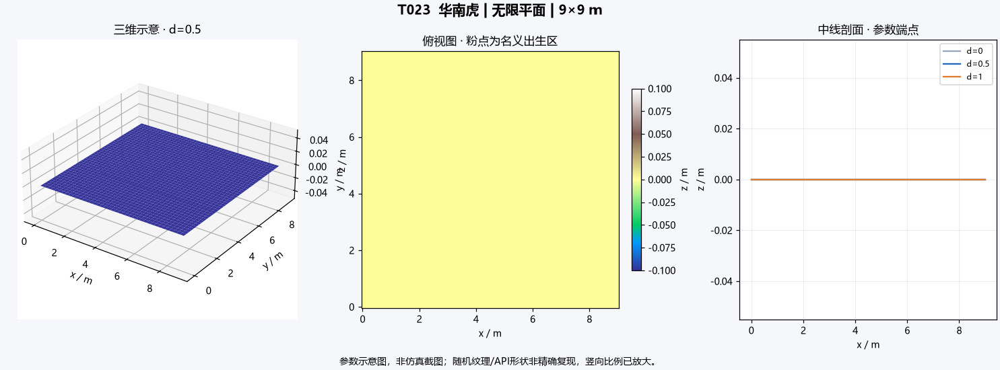

**说明：** 仅显示9×9米窗口

**使用配置：** 26_infantry\flat_and_rotation\2026-07-19_09-14-50；26_infantry\flat_and_rotation\2026-07-19_21-16-33；26_infantry\flat_and_rotation\2026-07-29_23-20-03

**来源：** D:\WHEEL_LEG_RL\wheeled-legged_RL\pretrained\26_infantry\flat_and_rotation\2026-07-19_09-14-50\params\env.yaml

完整绘图参数

| 字段 | 原值 |
|---|---|
|  | {} |

## T024 华南虎 / tiny_step_rot

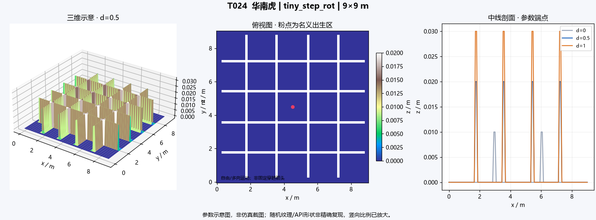

**说明：** 按参数重建形状示意；非Isaac碰撞网格，坡度不当弧度

**使用配置：** 26_infantry\rotation_translation\2026-07-28_00-39-42 / tiny_step_rot；26_infantry\rotation_translation\2026-07-28_23-17-10 / tiny_step_rot；26_infantry\rotation_translation\2026-07-29_18-15-16 / tiny_step_rot；26_infantry\rotation_translation\2026-07-30_14-44-58 / tiny_step_rot；26_infantry\rough_rotation_stair\2026-07-23_10-19-59 / tiny_step_rot；26_infantry\rough_rotation_stair\2026-07-23_16-23-21 / tiny_step_rot；26_infantry\rough_rotation_stair\2026-07-30_09-16-27 / tiny_step_rot

**来源：** D:\WHEEL_LEG_RL\wheeled-legged_RL\pretrained\26_infantry\rotation_translation\2026-07-28_00-39-42\params\env.yaml

完整绘图参数

| 字段 | 原值 |
|---|---|
| num_horizontal | null |
| num_horizontal_range | ["2", "4"] |
| num_vertical | null |
| num_vertical_range | ["2", "4"] |
| randomize_bar_count_difficulty | true |
| force_unequal_counts | false |
| force_even_counts | true |
| bar_width | null |
| bar_width_range | ["0.05", "0.2"] |
| randomize_bar_width_difficulty | true |
| bar_height | null |
| bar_height_range | ["0.01", "0.03"] |
| bar_length_ratio | 0.95 |
| ground_thickness | 0.05 |

## T025 华南虎 / slope_for_rm_low

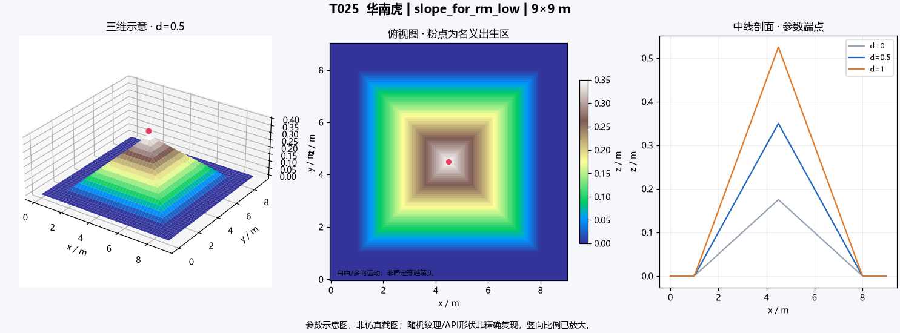

**说明：** 按参数重建形状示意；非Isaac碰撞网格，坡度不当弧度

**使用配置：** 26_infantry\rotation_translation\2026-07-28_00-39-42 / slope_for_rm_low；26_infantry\rotation_translation\2026-07-28_23-17-10 / slope_for_rm_low；26_infantry\rotation_translation\2026-07-29_18-15-16 / slope_for_rm_low；26_infantry\rotation_translation\2026-07-30_14-44-58 / slope_for_rm_low；26_infantry\rough_rotation_stair\2026-07-23_10-19-59 / slope_for_rm_low；26_infantry\rough_rotation_stair\2026-07-23_16-23-21 / slope_for_rm_low；26_infantry\rough_rotation_stair\2026-07-30_09-16-27 / slope_for_rm_low

**来源：** D:\WHEEL_LEG_RL\wheeled-legged_RL\pretrained\26_infantry\rotation_translation\2026-07-28_00-39-42\params\env.yaml

完整绘图参数

| 字段 | 原值 |
|---|---|
| border_width | 1.0 |
| horizontal_scale | 0.1 |
| vertical_scale | 0.005 |
| slope_threshold | 0.5 |
| slope_range | ["0.05", "0.15"] |
| platform_width | 0.0 |
| inverted | false |

## T026 华南虎 / inv_slope_for_rm_low

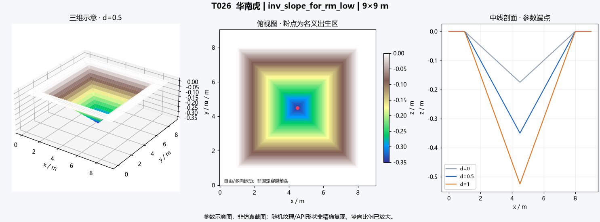

**说明：** 按参数重建形状示意；非Isaac碰撞网格，坡度不当弧度

**使用配置：** 26_infantry\rotation_translation\2026-07-28_00-39-42 / inv_slope_for_rm_low；26_infantry\rotation_translation\2026-07-28_23-17-10 / inv_slope_for_rm_low；26_infantry\rotation_translation\2026-07-29_18-15-16 / inv_slope_for_rm_low；26_infantry\rotation_translation\2026-07-30_14-44-58 / inv_slope_for_rm_low；26_infantry\rough_dash\2026-07-14_15-26-16 / inv_slope_for_rm_low；26_infantry\rough_dash\2026-07-19_19-15-07 / inv_slope_for_rm_low；26_infantry\rough_rotation_stair\2026-07-23_10-19-59 / inv_slope_for_rm_low；26_infantry\rough_rotation_stair\2026-07-23_16-23-21 / inv_slope_for_rm_low；26_infantry\rough_rotation_stair\2026-07-30_09-16-27 / inv_slope_for_rm_low

**来源：** D:\WHEEL_LEG_RL\wheeled-legged_RL\pretrained\26_infantry\rotation_translation\2026-07-28_00-39-42\params\env.yaml

完整绘图参数

| 字段 | 原值 |
|---|---|
| border_width | 1.0 |
| horizontal_scale | 0.1 |
| vertical_scale | 0.005 |
| slope_threshold | 0.5 |
| slope_range | ["0.05", "0.15"] |
| platform_width | 0.0 |
| inverted | true |

## T027 华南虎 / stair_slope_for_rm_low

**说明：** 按参数重建形状示意；非Isaac碰撞网格，坡度不当弧度

**使用配置：** 26_infantry\rotation_translation\2026-07-28_00-39-42 / stair_slope_for_rm_low；26_infantry\rotation_translation\2026-07-28_23-17-10 / stair_slope_for_rm_low；26_infantry\rotation_translation\2026-07-29_18-15-16 / stair_slope_for_rm_low；26_infantry\rotation_translation\2026-07-30_14-44-58 / stair_slope_for_rm_low；26_infantry\rough_rotation_stair\2026-07-23_10-19-59 / stair_slope_for_rm_low；26_infantry\rough_rotation_stair\2026-07-23_16-23-21 / stair_slope_for_rm_low；26_infantry\rough_rotation_stair\2026-07-30_09-16-27 / stair_slope_for_rm_low

**来源：** D:\WHEEL_LEG_RL\wheeled-legged_RL\pretrained\26_infantry\rotation_translation\2026-07-28_00-39-42\params\env.yaml

完整绘图参数

| 字段 | 原值 |
|---|---|
| border_width | 1.0 |
| horizontal_scale | 0.1 |
| vertical_scale | 0.005 |
| slope_threshold | 0.5 |
| step_height_range | ["0.005", "0.015"] |
| step_width | 0.1 |
| platform_width | 1.0 |
| inverted | false |

## T028 华南虎 / stair_slope_for_rm_mid

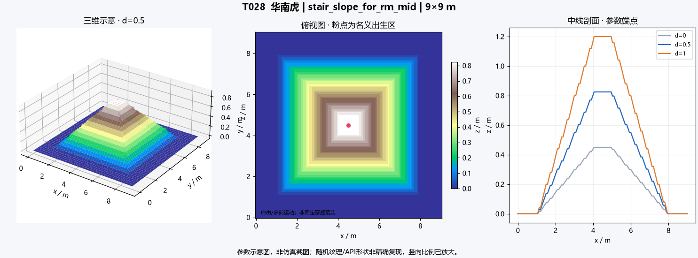

**说明：** 按参数重建形状示意；非Isaac碰撞网格，坡度不当弧度

**使用配置：** 26_infantry\rotation_translation\2026-07-28_00-39-42 / stair_slope_for_rm_mid

**来源：** D:\WHEEL_LEG_RL\wheeled-legged_RL\pretrained\26_infantry\rotation_translation\2026-07-28_00-39-42\params\env.yaml

完整绘图参数

| 字段 | 原值 |
|---|---|
| border_width | 1.0 |
| horizontal_scale | 0.1 |
| vertical_scale | 0.005 |
| slope_threshold | 0.5 |
| step_height_range | ["0.015", "0.04"] |
| step_width | 0.1 |
| platform_width | 1.0 |
| inverted | false |

## T029 华南虎 / inv_stair_slope_for_rm_low

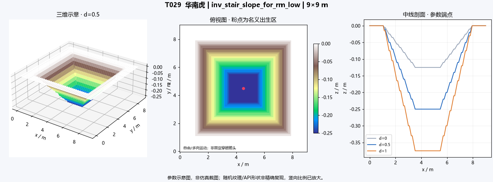

**说明：** 按参数重建形状示意；非Isaac碰撞网格，坡度不当弧度

**使用配置：** 26_infantry\rotation_translation\2026-07-28_00-39-42 / inv_stair_slope_for_rm_low；26_infantry\rotation_translation\2026-07-28_23-17-10 / inv_stair_slope_for_rm_low；26_infantry\rotation_translation\2026-07-29_18-15-16 / inv_stair_slope_for_rm_low；26_infantry\rotation_translation\2026-07-30_14-44-58 / inv_stair_slope_for_rm_low；26_infantry\rough_dash\2026-07-14_15-26-16 / inv_stair_slope_for_rm_low；26_infantry\rough_dash\2026-07-19_19-15-07 / inv_stair_slope_for_rm_low；26_infantry\rough_rotation_stair\2026-07-23_10-19-59 / inv_stair_slope_for_rm_low；26_infantry\rough_rotation_stair\2026-07-23_16-23-21 / inv_stair_slope_for_rm_low；26_infantry\rough_rotation_stair\2026-07-30_09-16-27 / inv_stair_slope_for_rm_low

**来源：** D:\WHEEL_LEG_RL\wheeled-legged_RL\pretrained\26_infantry\rotation_translation\2026-07-28_00-39-42\params\env.yaml

完整绘图参数

| 字段 | 原值 |
|---|---|
| border_width | 1.0 |
| horizontal_scale | 0.1 |
| vertical_scale | 0.005 |
| slope_threshold | 0.5 |
| step_height_range | ["0.005", "0.015"] |
| step_width | 0.1 |
| platform_width | 2.0 |
| inverted | true |

## T030 华南虎 / inv_stair_slope_for_rm_mid

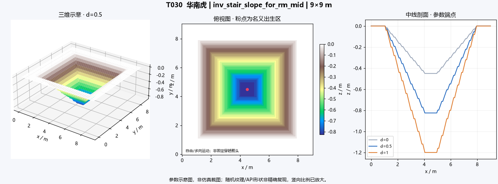

**说明：** 按参数重建形状示意；非Isaac碰撞网格，坡度不当弧度

**使用配置：** 26_infantry\rotation_translation\2026-07-28_00-39-42 / inv_stair_slope_for_rm_mid

**来源：** D:\WHEEL_LEG_RL\wheeled-legged_RL\pretrained\26_infantry\rotation_translation\2026-07-28_00-39-42\params\env.yaml

完整绘图参数

| 字段 | 原值 |
|---|---|
| border_width | 1.0 |
| horizontal_scale | 0.1 |
| vertical_scale | 0.005 |
| slope_threshold | 0.5 |
| step_height_range | ["0.015", "0.04"] |
| step_width | 0.1 |
| platform_width | 1.0 |
| inverted | true |

## T031 华南虎 / plane_for_rm_rot

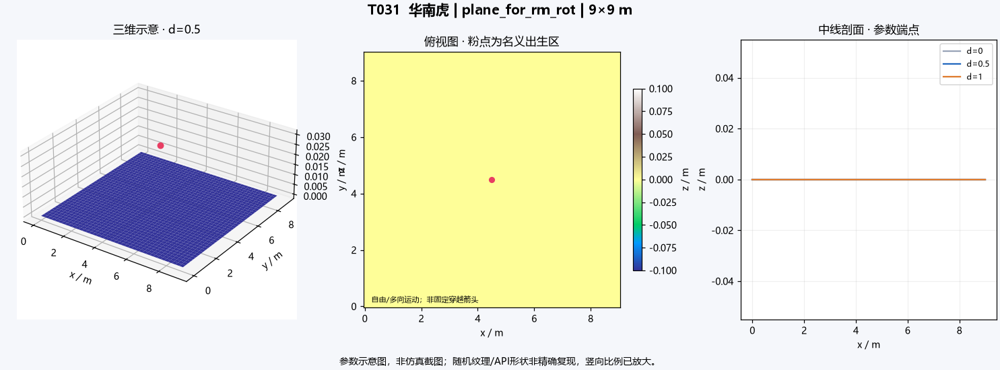

**说明：** 按参数重建形状示意；非Isaac碰撞网格，坡度不当弧度

**使用配置：** 26_infantry\rotation_translation\2026-07-28_00-39-42 / plane_for_rm_rot；26_infantry\rotation_translation\2026-07-28_23-17-10 / plane_for_rm_rot；26_infantry\rotation_translation\2026-07-29_18-15-16 / plane_for_rm_rot；26_infantry\rotation_translation\2026-07-30_14-44-58 / plane_for_rm_rot；26_infantry\rough_dash\2026-07-14_15-26-16 / plane_for_rm；26_infantry\rough_dash\2026-07-19_19-15-07 / plane_for_rm；26_infantry\rough_rotation_stair\2026-07-23_10-19-59 / plane_for_rm_rot；26_infantry\rough_rotation_stair\2026-07-23_16-23-21 / plane_for_rm_rot；26_infantry\rough_rotation_stair\2026-07-30_09-16-27 / plane_for_rm_rot

**来源：** D:\WHEEL_LEG_RL\wheeled-legged_RL\pretrained\26_infantry\rotation_translation\2026-07-28_00-39-42\params\env.yaml

完整绘图参数

| 字段 | 原值 |
|---|---|
|  | {} |

## T032 华南虎 / random_uniform_for_rm

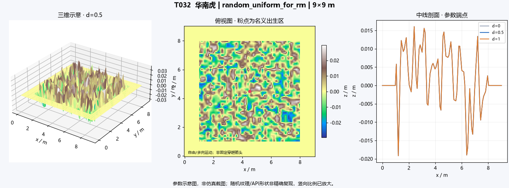

**说明：** 按参数重建形状示意；非Isaac碰撞网格，坡度不当弧度

**使用配置：** 26_infantry\rotation_translation\2026-07-28_00-39-42 / random_uniform_for_rm；26_infantry\rotation_translation\2026-07-28_23-17-10 / random_uniform_for_rm；26_infantry\rotation_translation\2026-07-29_18-15-16 / random_uniform_for_rm；26_infantry\rotation_translation\2026-07-30_14-44-58 / random_uniform_for_rm；26_infantry\rough_dash\2026-07-19_19-15-07 / random_uniform_for_rm；26_infantry\rough_rotation_stair\2026-07-23_10-19-59 / random_uniform_for_rm；26_infantry\rough_rotation_stair\2026-07-23_16-23-21 / random_uniform_for_rm；26_infantry\rough_rotation_stair\2026-07-30_09-16-27 / random_uniform_for_rm

**来源：** D:\WHEEL_LEG_RL\wheeled-legged_RL\pretrained\26_infantry\rotation_translation\2026-07-28_00-39-42\params\env.yaml

完整绘图参数

| 字段 | 原值 |
|---|---|
| border_width | 1.0 |
| horizontal_scale | 0.1 |
| vertical_scale | 0.005 |
| slope_threshold | 0.5 |
| noise_range | ["0.0", "0.03"] |
| noise_step | 0.005 |
| downsampled_scale | 0.2 |

## T033 华南虎 / tiny_step

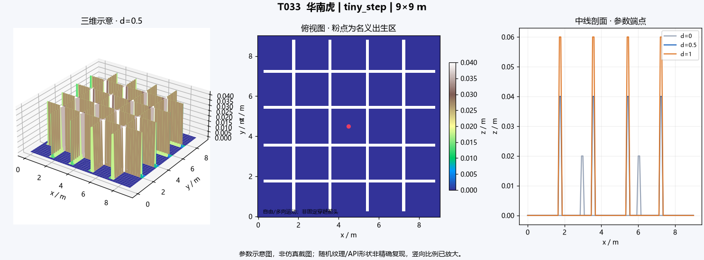

**说明：** 按参数重建形状示意；非Isaac碰撞网格，坡度不当弧度

**使用配置：** 26_infantry\rough_dash\2026-07-14_15-26-16 / tiny_step；26_infantry\rough_dash\2026-07-19_19-15-07 / tiny_step

**来源：** D:\WHEEL_LEG_RL\wheeled-legged_RL\pretrained\26_infantry\rough_dash\2026-07-14_15-26-16\params\env.yaml

完整绘图参数

| 字段 | 原值 |
|---|---|
| num_horizontal | null |
| num_horizontal_range | ["2", "4"] |
| num_vertical | null |
| num_vertical_range | ["2", "4"] |
| randomize_bar_count_difficulty | true |
| force_unequal_counts | false |
| force_even_counts | true |
| bar_width | null |
| bar_width_range | ["0.05", "0.2"] |
| randomize_bar_width_difficulty | true |
| bar_height | null |
| bar_height_range | ["0.02", "0.06"] |
| bar_length_ratio | 0.95 |
| ground_thickness | 0.05 |

## T034 华南虎 / slope_for_rm_high

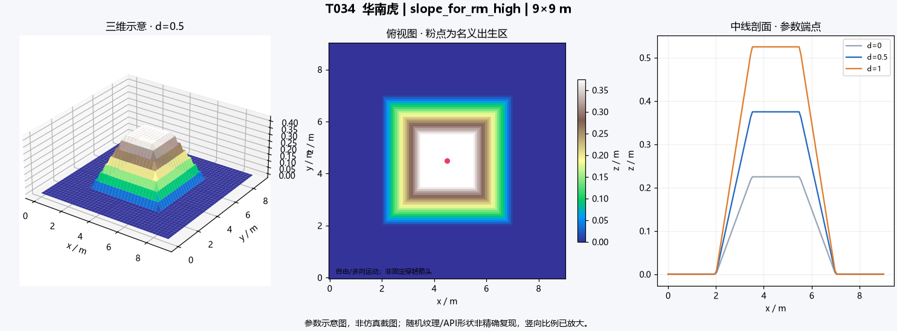

**说明：** 按参数重建形状示意；非Isaac碰撞网格，坡度不当弧度

**使用配置：** 26_infantry\rough_dash\2026-07-14_15-26-16 / slope_for_rm_high；26_infantry\rough_dash\2026-07-19_19-15-07 / slope_for_rm_high

**来源：** D:\WHEEL_LEG_RL\wheeled-legged_RL\pretrained\26_infantry\rough_dash\2026-07-14_15-26-16\params\env.yaml

完整绘图参数

| 字段 | 原值 |
|---|---|
| border_width | 2.0 |
| horizontal_scale | 0.1 |
| vertical_scale | 0.005 |
| slope_threshold | 0.5 |
| slope_range | ["0.15", "0.35"] |
| platform_width | 2.0 |
| inverted | false |

## T035 华南虎 / high_stair_for_rm

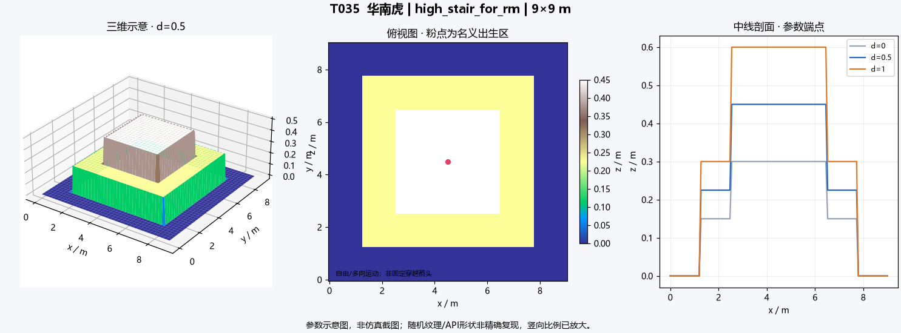

**说明：** 按参数重建形状示意；非Isaac碰撞网格，坡度不当弧度

**使用配置：** 26_infantry\rough_dash\2026-07-14_15-26-16 / high_stair_for_rm

**来源：** D:\WHEEL_LEG_RL\wheeled-legged_RL\pretrained\26_infantry\rough_dash\2026-07-14_15-26-16\params\env.yaml

完整绘图参数

| 字段 | 原值 |
|---|---|
| border_width | 0.0 |
| horizontal_scale | 0.1 |
| vertical_scale | 0.005 |
| slope_threshold | 0.5 |
| step_height_range | ["0.15", "0.3"] |
| step_width | 1.25 |
| platform_width | 2.5 |
| inverted | false |

## T036 华南虎 / stair_slope_for_rm_high

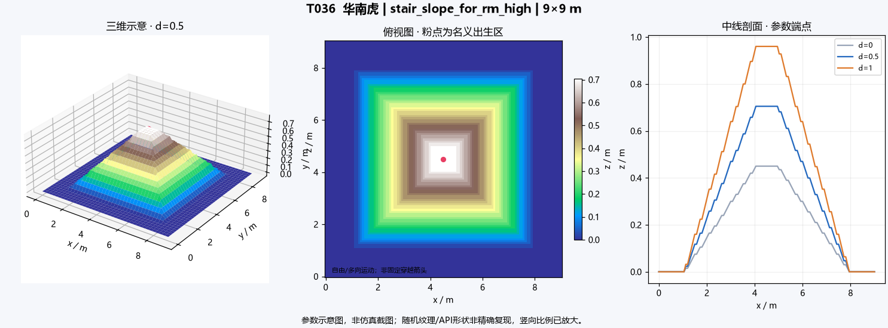

**说明：** 按参数重建形状示意；非Isaac碰撞网格，坡度不当弧度

**使用配置：** 26_infantry\rough_dash\2026-07-14_15-26-16 / stair_slope_for_rm_high；26_infantry\rough_dash\2026-07-19_19-15-07 / stair_slope_for_rm_high

**来源：** D:\WHEEL_LEG_RL\wheeled-legged_RL\pretrained\26_infantry\rough_dash\2026-07-14_15-26-16\params\env.yaml

完整绘图参数

| 字段 | 原值 |
|---|---|
| border_width | 1.0 |
| horizontal_scale | 0.1 |
| vertical_scale | 0.005 |
| slope_threshold | 0.5 |
| step_height_range | ["0.015", "0.032"] |
| step_width | 0.1 |
| platform_width | 1.0 |
| inverted | false |

## T037 华南虎 / inv_stair_slope_for_rm_high

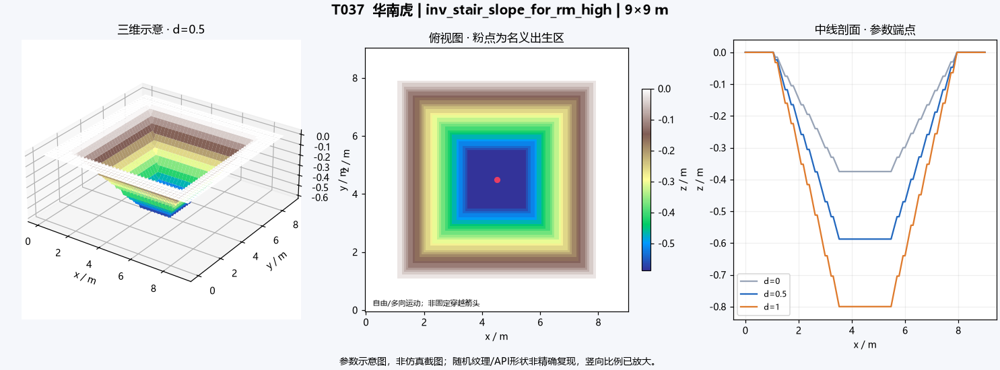

**说明：** 按参数重建形状示意；非Isaac碰撞网格，坡度不当弧度

**使用配置：** 26_infantry\rough_dash\2026-07-14_15-26-16 / inv_stair_slope_for_rm_high；26_infantry\rough_dash\2026-07-19_19-15-07 / inv_stair_slope_for_rm_high

**来源：** D:\WHEEL_LEG_RL\wheeled-legged_RL\pretrained\26_infantry\rough_dash\2026-07-14_15-26-16\params\env.yaml

完整绘图参数

| 字段 | 原值 |
|---|---|
| border_width | 1.0 |
| horizontal_scale | 0.1 |
| vertical_scale | 0.005 |
| slope_threshold | 0.5 |
| step_height_range | ["0.015", "0.032"] |
| step_width | 0.1 |
| platform_width | 2.0 |
| inverted | true |

## T038 华南虎 / random_uniform_for_rm

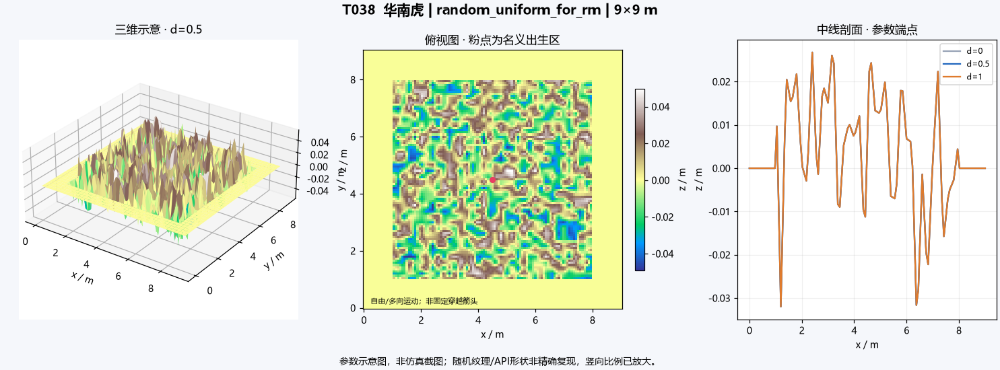

**说明：** 按参数重建形状示意；非Isaac碰撞网格，坡度不当弧度

**使用配置：** 26_infantry\rough_dash\2026-07-14_15-26-16 / random_uniform_for_rm

**来源：** D:\WHEEL_LEG_RL\wheeled-legged_RL\pretrained\26_infantry\rough_dash\2026-07-14_15-26-16\params\env.yaml

完整绘图参数

| 字段 | 原值 |
|---|---|
| border_width | 1.0 |
| horizontal_scale | 0.1 |
| vertical_scale | 0.005 |
| slope_threshold | 0.5 |
| noise_range | ["0.0", "0.05"] |
| noise_step | 0.005 |
| downsampled_scale | 0.2 |

## T039 华南虎 / cliff_inv_stair_slope_short_for_rm

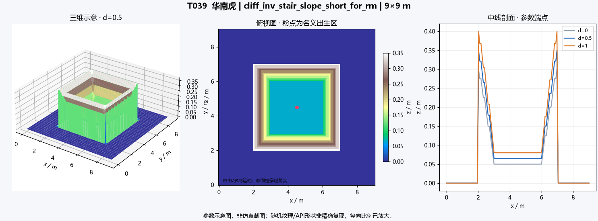

**说明：** 按参数重建形状示意；非Isaac碰撞网格，坡度不当弧度

**使用配置：** 26_infantry\rough_dash\2026-07-14_15-26-16 / cliff_inv_stair_slope_short_for_rm；26_infantry\rough_dash\2026-07-19_19-15-07 / cliff_inv_stair_slope_short_for_rm

**来源：** D:\WHEEL_LEG_RL\wheeled-legged_RL\pretrained\26_infantry\rough_dash\2026-07-14_15-26-16\params\env.yaml

完整绘图参数

| 字段 | 原值 |
|---|---|
| border_width | 2.0 |
| horizontal_scale | 0.1 |
| vertical_scale | 0.005 |
| slope_threshold | 0.5 |
| step_height_range | ["0.025", "0.032"] |
| step_width | 0.1 |
| platform_width | 3.0 |
| height_offset | null |
| height_offset_range | ["0.3", "0.4"] |
| height_offset_curriculum_scale_by_difficulty | false |
| height_offset_curriculum_num_levels | 11 |

## T040 华南虎 / low_speed_stair_for_rm

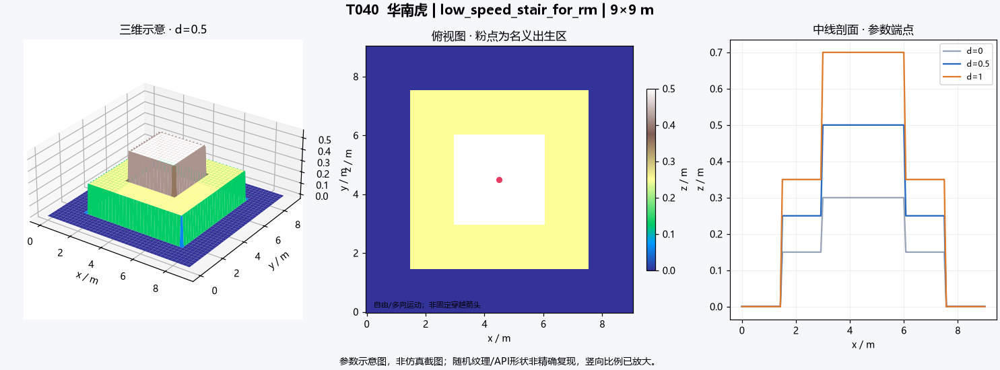

**说明：** 按参数重建形状示意；非Isaac碰撞网格，坡度不当弧度

**使用配置：** 26_infantry\rough_dash\2026-07-19_19-15-07 / low_speed_stair_for_rm

**来源：** D:\WHEEL_LEG_RL\wheeled-legged_RL\pretrained\26_infantry\rough_dash\2026-07-19_19-15-07\params\env.yaml

完整绘图参数

| 字段 | 原值 |
|---|---|
| border_width | 0.0 |
| horizontal_scale | 0.1 |
| vertical_scale | 0.005 |
| slope_threshold | 0.5 |
| step_height_range | ["0.15", "0.35"] |
| step_width | 1.5 |
| platform_width | 3.0 |
| inverted | false |

## T041 华南虎 / high_speed_stair_for_rm

**说明：** 按参数重建形状示意；非Isaac碰撞网格，坡度不当弧度

**使用配置：** 26_infantry\rough_dash\2026-07-19_19-15-07 / high_speed_stair_for_rm

**来源：** D:\WHEEL_LEG_RL\wheeled-legged_RL\pretrained\26_infantry\rough_dash\2026-07-19_19-15-07\params\env.yaml

完整绘图参数

| 字段 | 原值 |
|---|---|
| border_width | 0.0 |
| horizontal_scale | 0.1 |
| vertical_scale | 0.005 |
| slope_threshold | 0.5 |
| step_height_range | ["0.15", "0.4"] |
| step_width | 1.5 |
| platform_width | 3.0 |
| inverted | false |

## T042 华南虎 / stair_slope_for_rm_mid

**说明：** 按参数重建形状示意；非Isaac碰撞网格，坡度不当弧度

**使用配置：** 26_infantry\rough_rotation_stair\2026-07-23_16-23-21 / stair_slope_for_rm_mid；26_infantry\rough_rotation_stair\2026-07-30_09-16-27 / stair_slope_for_rm_mid

**来源：** D:\WHEEL_LEG_RL\wheeled-legged_RL\pretrained\26_infantry\rough_rotation_stair\2026-07-23_16-23-21\params\env.yaml

完整绘图参数

| 字段 | 原值 |
|---|---|
| border_width | 1.0 |
| horizontal_scale | 0.1 |
| vertical_scale | 0.005 |
| slope_threshold | 0.5 |
| step_height_range | ["0.025", "0.04"] |
| step_width | 0.1 |
| platform_width | 1.0 |
| inverted | false |

## T043 华南虎 / inv_stair_slope_for_rm_mid

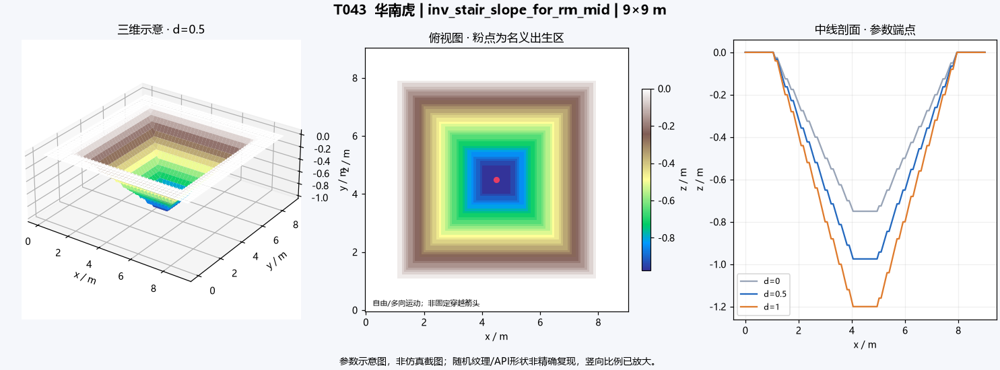

**说明：** 按参数重建形状示意；非Isaac碰撞网格，坡度不当弧度

**使用配置：** 26_infantry\rough_rotation_stair\2026-07-23_16-23-21 / inv_stair_slope_for_rm_mid；26_infantry\rough_rotation_stair\2026-07-30_09-16-27 / inv_stair_slope_for_rm_mid

**来源：** D:\WHEEL_LEG_RL\wheeled-legged_RL\pretrained\26_infantry\rough_rotation_stair\2026-07-23_16-23-21\params\env.yaml

完整绘图参数

| 字段 | 原值 |
|---|---|
| border_width | 1.0 |
| horizontal_scale | 0.1 |
| vertical_scale | 0.005 |
| slope_threshold | 0.5 |
| step_height_range | ["0.025", "0.04"] |
| step_width | 0.1 |
| platform_width | 1.0 |
| inverted | true |

## T044 复旦 / 平地

**说明：** 历史未保存terrain.py，按现有工具示意，不能证明历史网格

**使用配置：** plane历史trimesh；当前plane/jump均用plane

**来源：** plane/wheel_legged_gym/utils/terrain.py:make_terrain

完整绘图参数

| 字段 | 原值 |
|---|---|
| difficulty | 0 / 0.5 / 1 (参数端点) |
| slope | 0.5*d (粗糙坡再乘0.5) |
| step_height_m | 0.05+0.18*d |
| step_width_m | 0.7 |
| noise_amplitude_m | 0.05+0.05*d |
| obstacle_count | 20 |
| obstacle_width_m | [1, 2] |
| stone_gap_depth_display_m | -0.35，仅显示示意，不是配置值 |

## T045 复旦 / 光滑凸坡

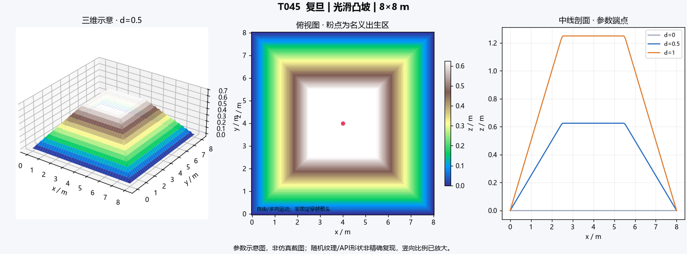

**说明：** 历史未保存terrain.py，按现有工具示意，不能证明历史网格

**使用配置：** plane历史trimesh；当前plane/jump均用plane

**来源：** plane/wheel_legged_gym/utils/terrain.py:make_terrain

完整绘图参数

| 字段 | 原值 |
|---|---|
| difficulty | 0 / 0.5 / 1 (参数端点) |
| slope | 0.5*d (粗糙坡再乘0.5) |
| step_height_m | 0.05+0.18*d |
| step_width_m | 0.7 |
| noise_amplitude_m | 0.05+0.05*d |
| obstacle_count | 20 |
| obstacle_width_m | [1, 2] |
| stone_gap_depth_display_m | -0.35，仅显示示意，不是配置值 |

## T046 复旦 / 光滑凹坡

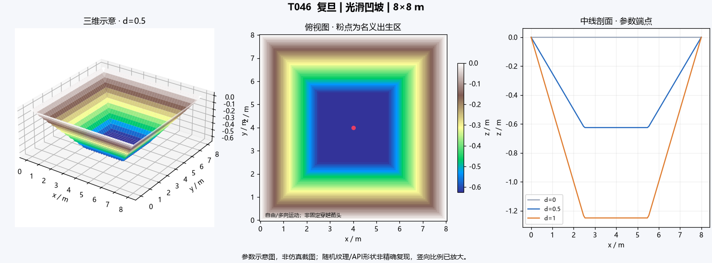

**说明：** 历史未保存terrain.py，按现有工具示意，不能证明历史网格

**使用配置：** plane历史trimesh；当前plane/jump均用plane

**来源：** plane/wheel_legged_gym/utils/terrain.py:make_terrain

完整绘图参数

| 字段 | 原值 |
|---|---|
| difficulty | 0 / 0.5 / 1 (参数端点) |
| slope | 0.5*d (粗糙坡再乘0.5) |
| step_height_m | 0.05+0.18*d |
| step_width_m | 0.7 |
| noise_amplitude_m | 0.05+0.05*d |
| obstacle_count | 20 |
| obstacle_width_m | [1, 2] |
| stone_gap_depth_display_m | -0.35，仅显示示意，不是配置值 |

## T047 复旦 / 粗糙凸坡

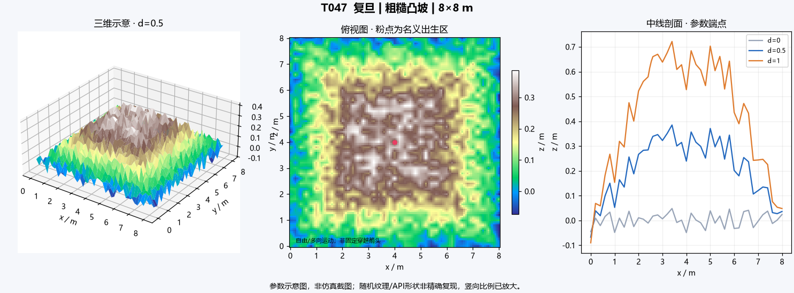

**说明：** 历史未保存terrain.py，按现有工具示意，不能证明历史网格

**使用配置：** plane历史trimesh；当前plane/jump均用plane

**来源：** plane/wheel_legged_gym/utils/terrain.py:make_terrain

完整绘图参数

| 字段 | 原值 |
|---|---|
| difficulty | 0 / 0.5 / 1 (参数端点) |
| slope | 0.5*d (粗糙坡再乘0.5) |
| step_height_m | 0.05+0.18*d |
| step_width_m | 0.7 |
| noise_amplitude_m | 0.05+0.05*d |
| obstacle_count | 20 |
| obstacle_width_m | [1, 2] |
| stone_gap_depth_display_m | -0.35，仅显示示意，不是配置值 |

## T048 复旦 / 粗糙凹坡

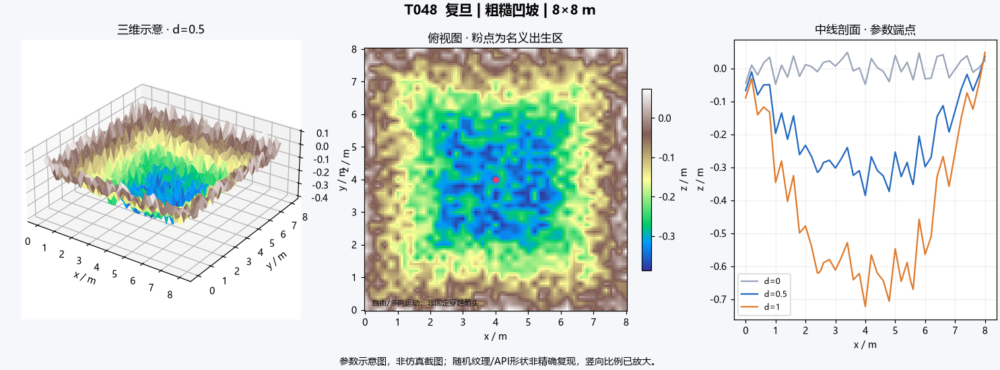

**说明：** 历史未保存terrain.py，按现有工具示意，不能证明历史网格

**使用配置：** plane历史trimesh；当前plane/jump均用plane

**来源：** plane/wheel_legged_gym/utils/terrain.py:make_terrain

完整绘图参数

| 字段 | 原值 |
|---|---|
| difficulty | 0 / 0.5 / 1 (参数端点) |
| slope | 0.5*d (粗糙坡再乘0.5) |
| step_height_m | 0.05+0.18*d |
| step_width_m | 0.7 |
| noise_amplitude_m | 0.05+0.05*d |
| obstacle_count | 20 |
| obstacle_width_m | [1, 2] |
| stone_gap_depth_display_m | -0.35，仅显示示意，不是配置值 |

## T049 复旦 / 下阶凹地形

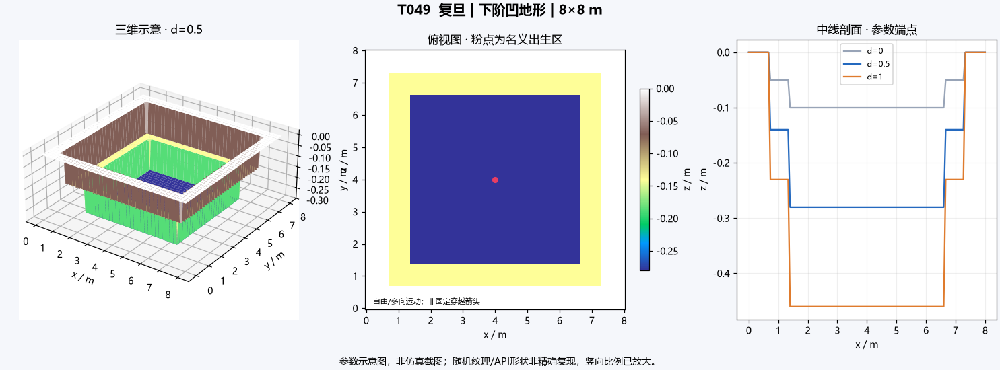

**说明：** 历史未保存terrain.py，按现有工具示意，不能证明历史网格

**使用配置：** plane历史trimesh；当前plane/jump均用plane

**来源：** plane/wheel_legged_gym/utils/terrain.py:make_terrain

完整绘图参数

| 字段 | 原值 |
|---|---|
| difficulty | 0 / 0.5 / 1 (参数端点) |
| slope | 0.5*d (粗糙坡再乘0.5) |
| step_height_m | 0.05+0.18*d |
| step_width_m | 0.7 |
| noise_amplitude_m | 0.05+0.05*d |
| obstacle_count | 20 |
| obstacle_width_m | [1, 2] |
| stone_gap_depth_display_m | -0.35，仅显示示意，不是配置值 |

## T050 复旦 / 上阶凸地形

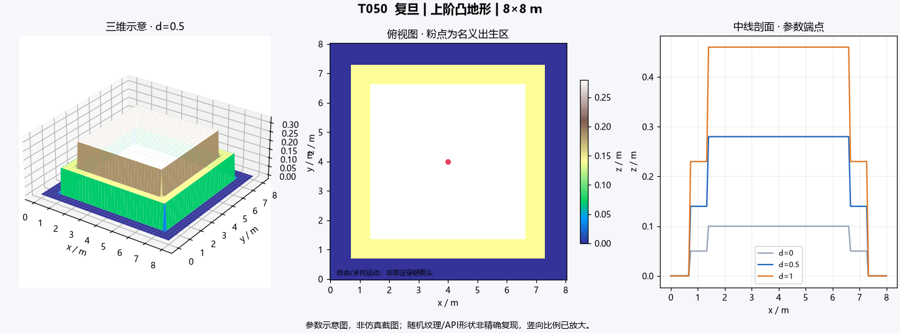

**说明：** 历史未保存terrain.py，按现有工具示意，不能证明历史网格

**使用配置：** plane历史trimesh；当前plane/jump均用plane

**来源：** plane/wheel_legged_gym/utils/terrain.py:make_terrain

完整绘图参数

| 字段 | 原值 |
|---|---|
| difficulty | 0 / 0.5 / 1 (参数端点) |
| slope | 0.5*d (粗糙坡再乘0.5) |
| step_height_m | 0.05+0.18*d |
| step_width_m | 0.7 |
| noise_amplitude_m | 0.05+0.05*d |
| obstacle_count | 20 |
| obstacle_width_m | [1, 2] |
| stone_gap_depth_display_m | -0.35，仅显示示意，不是配置值 |

## T051 复旦 / 离散障碍

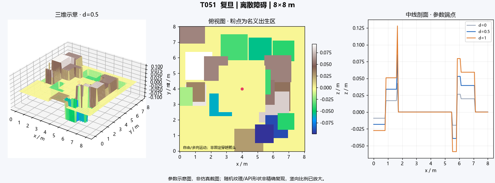

**说明：** 历史未保存terrain.py，按现有工具示意，不能证明历史网格

**使用配置：** plane历史trimesh；当前plane/jump均用plane

**来源：** plane/wheel_legged_gym/utils/terrain.py:make_terrain

完整绘图参数

| 字段 | 原值 |
|---|---|
| difficulty | 0 / 0.5 / 1 (参数端点) |
| slope | 0.5*d (粗糙坡再乘0.5) |
| step_height_m | 0.05+0.18*d |
| step_width_m | 0.7 |
| noise_amplitude_m | 0.05+0.05*d |
| obstacle_count | 20 |
| obstacle_width_m | [1, 2] |
| stone_gap_depth_display_m | -0.35，仅显示示意，不是配置值 |

## T052 复旦 / 踏石（未启用）

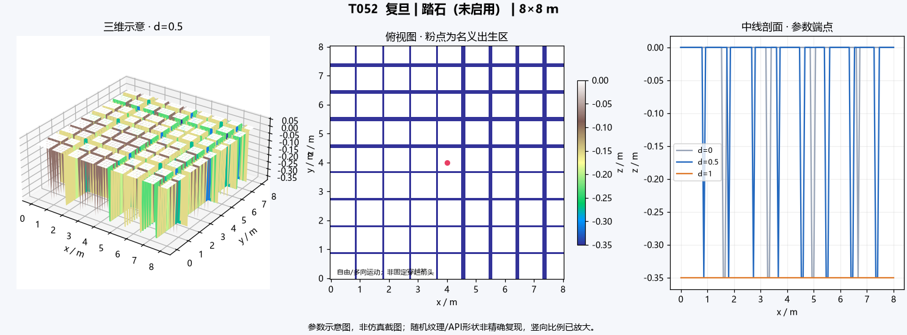

**说明：** 生成分支存在，但所查配置均未启用；踏石间隙示意深度非配置值

**使用配置：** plane历史trimesh；当前plane/jump均用plane

**来源：** plane/wheel_legged_gym/utils/terrain.py:make_terrain

完整绘图参数

| 字段 | 原值 |
|---|---|
| difficulty | 0 / 0.5 / 1 (参数端点) |
| slope | 0.5*d (粗糙坡再乘0.5) |
| step_height_m | 0.05+0.18*d |
| step_width_m | 0.7 |
| noise_amplitude_m | 0.05+0.05*d |
| obstacle_count | 20 |
| obstacle_width_m | [1, 2] |
| stone_gap_depth_display_m | -0.35，仅显示示意，不是配置值 |

## T053 复旦 / 沟槽（未启用）

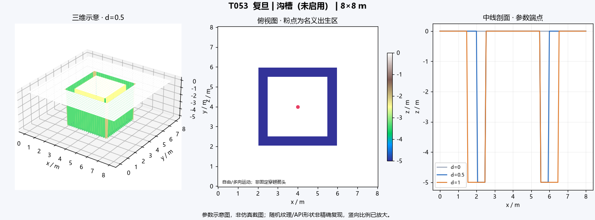

**说明：** 生成分支存在，但所查配置均未启用；踏石间隙示意深度非配置值

**使用配置：** plane历史trimesh；当前plane/jump均用plane

**来源：** plane/wheel_legged_gym/utils/terrain.py:make_terrain

完整绘图参数

| 字段 | 原值 |
|---|---|
| difficulty | 0 / 0.5 / 1 (参数端点) |
| slope | 0.5*d (粗糙坡再乘0.5) |
| step_height_m | 0.05+0.18*d |
| step_width_m | 0.7 |
| noise_amplitude_m | 0.05+0.05*d |
| obstacle_count | 20 |
| obstacle_width_m | [1, 2] |
| stone_gap_depth_display_m | -0.35，仅显示示意，不是配置值 |

## T054 复旦 / 坑（未启用）

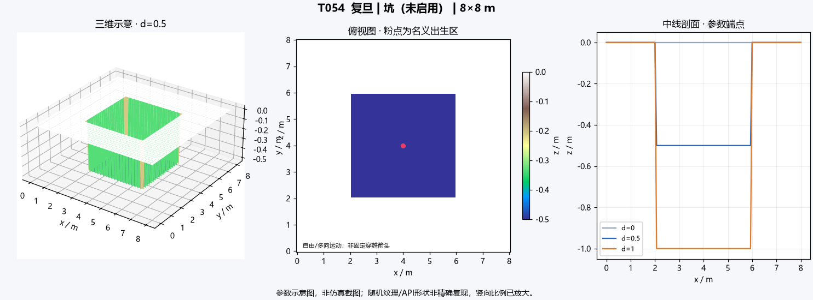

**说明：** 生成分支存在，但所查配置均未启用；踏石间隙示意深度非配置值

**使用配置：** plane历史trimesh；当前plane/jump均用plane

**来源：** plane/wheel_legged_gym/utils/terrain.py:make_terrain

完整绘图参数

| 字段 | 原值 |
|---|---|
| difficulty | 0 / 0.5 / 1 (参数端点) |
| slope | 0.5*d (粗糙坡再乘0.5) |
| step_height_m | 0.05+0.18*d |
| step_width_m | 0.7 |
| noise_amplitude_m | 0.05+0.05*d |
| obstacle_count | 20 |
| obstacle_width_m | [1, 2] |
| stone_gap_depth_display_m | -0.35，仅显示示意，不是配置值 |

